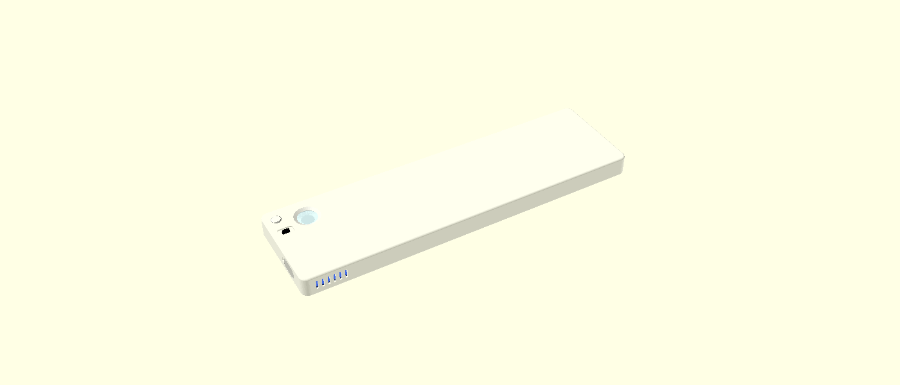
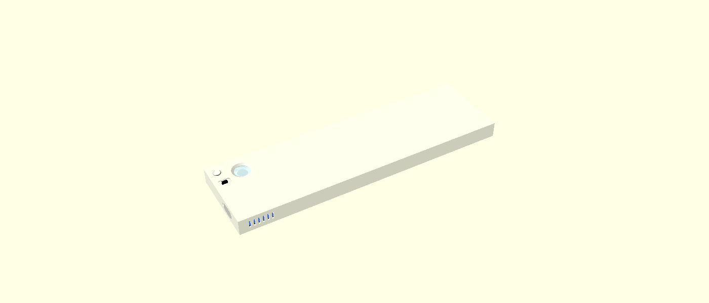
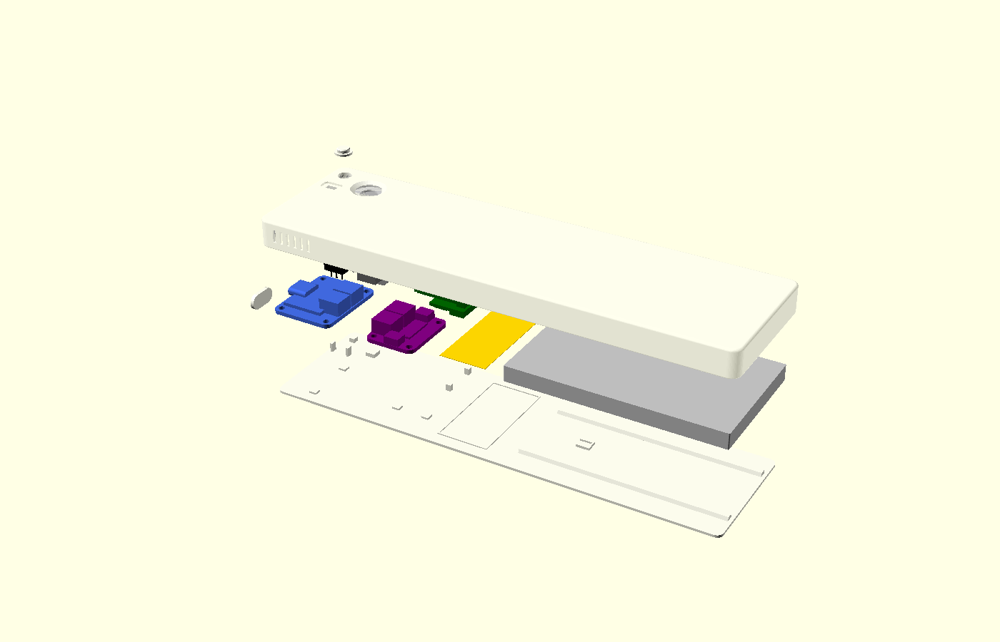
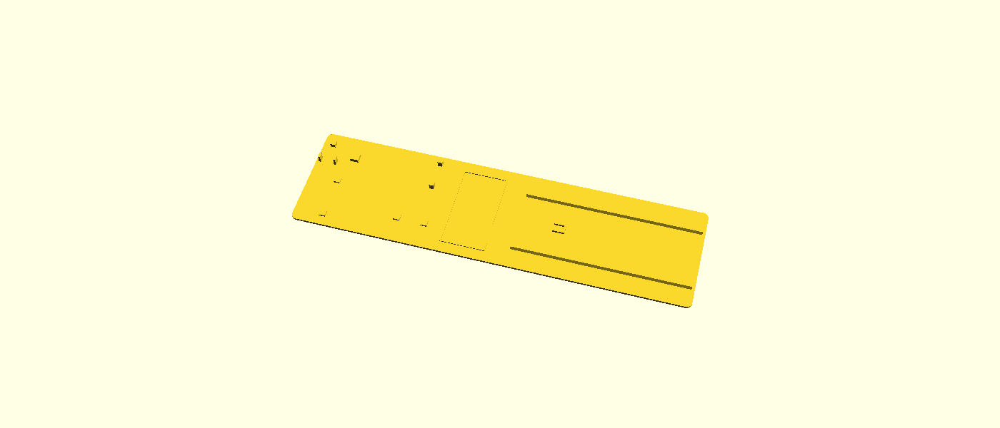
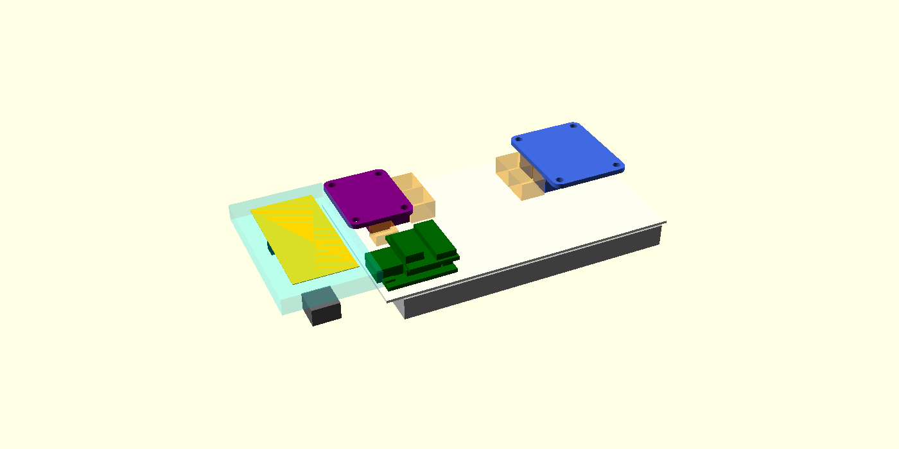
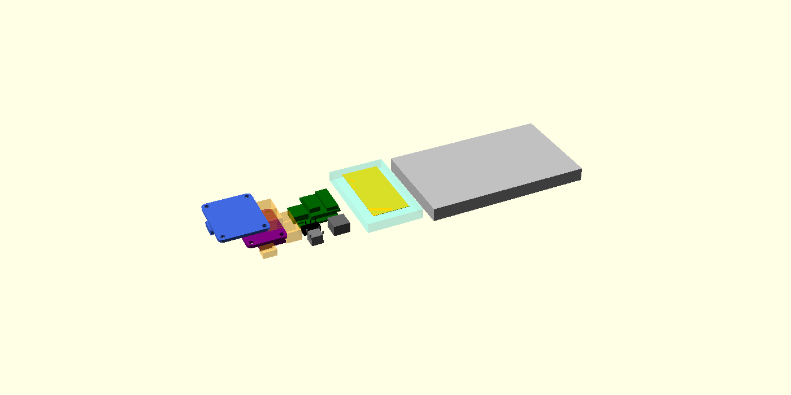

# Thin desk power bank: enclosure (OpenSCAD)

**Bottom line: layout 3 (single deck, antenna bay) is the smallest layout that meets both rules.**
- **Outer size:** **188.9 × 54.1 × 11.0 mm** for version 2 (rounded), **188.8 × 54.1 × 11.0 mm** for version 1 (sharp). That is 112 cm³. The cell alone is 85 × 50 × 6.3.
- **Rule 1, unplugging:** every JST-PH and STEMMA QT plug can be pulled from the back opening with ≥ 3 mm finger room on each side. Nothing else has to come out first. The camera-FPC latch also faces the back.
- **Rule 2, antenna:** **5.0 mm** from the nearest metal (the XIAO end) and **10.6 mm** from the cell foil. It is never over the cell. Plastic surrounds it on 4 sides: both side walls, the front wall and the plug.
- **Checks:** **67 / 67 pass** in version 1, version 2 and removable-plug mode. That is your 47 collision pairs, plus 10 antenna keep-out pairs and 10 finger-access pairs.
- **Cost against the previous design** (175.7 mm long, which broke both rules): **+13.2 mm of length**. The breakdown is in [Size](#3-size-and-layout-comparison).
- **STLs** are in `enclosure/stl/`. **Measure the cell (lead length too), camera head, antenna and cable overmold before ordering.**

| Version 2 (rounded) | Version 1 (sharp) |
|---|---|
|  |  |

Layout seen from the front, body hidden. The colours are the dummies, the plug zones (orange), the finger-access columns (green) and the antenna keep-out (cyan):




Inside of the body (seen from the back, plug removed): the bay fences, and the wire shelf along the near wall. Then the plug:




Files

| File | What |
|---|---|
| `enclosure/powerbank.scad` | The model (layout 3). Parameters at the top, one module per part |
| `enclosure/stl/` | Exported STLs, see the list below |
| `enclosure/layout_studies.scad` | Placement models of layouts 1 and 2, used for the comparison table |
| `enclosure/tools/run_checks.sh` | Runs the asserts, all 67 intersection pairs and the part renders |
| `enclosure/tools/run_studies.sh` | Runs the 42 placement checks for each of layouts 1 and 2 |
| `enclosure/tools/stl_volume.py` | Volume of an STL. An intersection with < 0.001 mm³ counts as touching only |
| `enclosure/check_results/` | Check output |
| `enclosure/img/` | Preview renders |
| `tools/*.py` | How the STEP, Eagle and DXF files were measured (`pip install cadquery-ocp ezdxf`) |
| `reference/XIAO_ESP32S3_Sense.step` | Your STEP file, copied from the upload |
| `reference/measurements.txt` | Raw measurement output |

STLs in `enclosure/stl/` (all render as single manifold solids):

| File | Part |
|---|---|
| `body_v2_rounded.stl`, `body_v1_sharp.stl` | Body (tray), version 2 / version 1 |
| `plug_v2_rounded.stl`, `plug_v1_sharp.stl` | Bottom plug, permanent (epoxy) |
| `plug_v2_rounded_removable.stl`, `plug_v1_sharp_removable.stl` | Bottom plug, removable (crush ribs). Use this while developing |
| `usb_cover_A.stl`, `_B`, `_C` | Charging-port cover, three fits |
| `button_cap.stl` | Button cap (prints head down) |
| `fit_coupon.stl` | Fit coupon. Print it first |

To re-export after changing a parameter:

```
openscad -o body.stl -D 'part="body"' -D 'style="rounded"' enclosure/powerbank.scad   # part = body | plug | usb_cover_A/B/C | button_cap | coupon
```
- **Views:** `assembled`, `exploded`, `section` (cut through the lens), `layout` (no body, with zones and keep-out), `debug` (intersections).
- **Switches:** `style`, `charge_port`, `plug_mode`, `has_button`, `antenna_place` (`bay` or `none`), `board_connectors`, `vents`, `show_lanes`.

---

## 1. Checked dimensions

Confidence levels: **confirmed** = two independent sources agree, or a manufacturer CAD/board file. **single** = one source. **assumed** = no source found; the value is a marked parameter.

| Dimension | Used | Source | Confidence |
|---|---|---|---|
| Cell 635085 T × W × L | 6.3 × 50 × 85 (±5 %) | [Tempero listing](https://temperosystems.com.au/?p=35057). Only seen in the search snippet: a direct fetch returned HTTP 403 | single |
| Cell corner radius, length of the lead end | 0.5, 5.0 zone | none | **assumed** |
| bq25185 PCB | **31.75 × 25.40** × 1.57, corners r 2.54 | [Eagle rev B1](https://github.com/adafruit/Adafruit-bq25185-Charger-Breakout-PCB) and [Adafruit STEP](https://github.com/adafruit/Adafruit_CAD_Parts/tree/main/6091%20bq25185%20USB%20Charger) | confirmed |
| bq25185 USB-C shell | 8.94 × 3.21, r 1.25. Overhangs the board edge by **0.986** | Adafruit STEP (CUI CUSB31-CFM2AX-01-X) | single (CAD) |
| bq25185 holes | 4 × Ø2.5 at (2.54, 2.54), (29.21, 2.54), (2.54, 22.86), (29.21, 22.86) | Eagle | confirmed |
| bq25185 JST-PH height above the PCB | **5.6** | [product page](https://www.adafruit.com/product/6091): 7.2 total. [JLCPCB S2B-PH-SM4-TB](https://jlcpcb.com/partdetail/JST-S2B_PH_SM4_TB_LF_SN/C295747): 5.5 | confirmed (2 sources) |
| MAX17048 PCB | **25.40 × 20.32** × 1.57, r 2.54 | [Eagle](https://github.com/adafruit/Adafruit-MAX17048-PCB) and [Adafruit STEP](https://github.com/adafruit/Adafruit_CAD_Parts/tree/main/5580%20MAX17048) | confirmed |
| MAX17048 holes | **4 holes**: Ø2.5 at (2.54, 2.54) and (22.86, 2.54), Ø2.54 at (2.54, 17.78) and (22.86, 17.78) | Eagle, product photo | confirmed |
| MAX17048 STEMMA QT height | 2.96 above the PCB | Adafruit STEP | single (CAD) |
| XIAO PCB | **21.14** × 17.78 × 1.25 | [Seeed dimension DXF](https://files.seeedstudio.com/wiki/SeeedStudio-XIAO-ESP32S3/res/XIAO_ESP32S3_v1.1_Dimensioning.dxf): 21.135 × 17.78. STEP: 20.955 × 17.78. [Wiki](https://wiki.seeedstudio.com/xiao_esp32s3_getting_started): 21 × 17.8 | confirmed (larger value used) |
| XIAO USB-C | 7.90 deep × 8.94 wide, top 4.46 above the PCB back, **1.527** past the PCB end | STEP | single (CAD) |
| Expansion board PCB | 14.68 × 16.78 (STEP); 15.37 × 17.78 (Seeed v1.0 DXF) | STEP / [DXF](https://files.seeedstudio.com/wiki/SeeedStudio-XIAO-ESP32S3/res/XIAO_ESP32S3_ExpBoard_v1.0_top.dxf) | **conflict**: modelled as the full XIAO width, extending 0.6 past the far end |
| XIAO + expansion stack, no card | **8.03** (PCB back to the microSD socket top) | STEP | single (CAD) |
| Same, with card | 8.50 | STEP (card model) | single (CAD) |
| Camera FPC connector (AFC01-S24) | 6.0 × 16.2 × 2.01, top 7.43 above the PCB back | STEP | single (CAD) |
| OV5640 head (default) | **8.5 × 8.5 ±0.2**, height 5.5 (block 5.0 + barrel 0.5), FPC 6 wide, 70.5 long | [Seeed OV5640 AF spec](https://files.seeedstudio.com/wiki/SeeedStudio-XIAO-ESP32S3/new-res/OV5640_Camera_Module_Specification.pdf) | single (vendor drawing) |
| Your wide-angle AF head | none | none | **assumed: parameter, measure** |
| SS-12D00 body / handle / travel / pitch | 8.8 × 3.9 × 3.5 / 1.5 × 1.5 / 2.0 / 2.5 | [Sofng drawing](https://atta.szlcsc.com/upload/public/pdf/source/20240529/1037A069FE9BBCECE56007AB916D4384.pdf) | single (drawing) |
| SS-12D00-G3 handle height | 3.0 above the body | retailer listings ("3 mm handle") | single |
| SS-12D00 pin length | 3.5 | none (not dimensioned) | **assumed** |
| Tact switch 6 × 6, body 3.5, plunger Ø3.5, travel 0.25 | as listed | Omron B3F distributor pages ([Farnell](https://uk.farnell.com/omron/b3f-1000/switch-spno-0-05a-24v-tht-0-98n/dp/176432), [LCSC](https://www.lcsc.com/product-detail/C93157.html)) | single |
| FPC antenna | 39 × 19 | [one forum report](https://forum.core-electronics.com.au/t/seeed-studio-xiao-esp32s3-sense-ss113991115/23335) | **assumed** |
| USB-C cable overmold the well must accept | 12.35 × 6.5 (well 12.4 × 6.6) | nothing authoritative found | **assumed: measure your cable** |
| 9000HE: tolerance ±0.2 (< 100) / ±0.3 % (> 100), wall > 0.8, HDT 60 °C, Tg 61-68 °C | as listed | [JLC3DP](https://jlc3dp.com/help/article/9000he-resin) | single (vendor) |

### Numbers that differ from yours by more than 0.3 mm
| Item | You | Found | Used |
|---|---|---|---|
| bq25185 width | 26.3 | **25.40** PCB. Your 26.3 includes the USB-C overhang (25.40 + 0.986) | 25.40 + overhang |
| bq25185 / MAX17048 height | 7.2 | 7.2 (product page) and 5.5 + 1.57 = 7.07 (distributor). Adafruit's own STEP shows 6.37 (JST 4.8) | 7.17 (connector 5.6) |
| Camera head | 8 × 8 × 2.1, barrel Ø6.55 × 3.66 | That head in the STEP is the **old stock camera, not an OV5640**: block 8.0 × 8.0 × 2.10, barrel **Ø7.85** at the base, then Ø6.32, then Ø6.0. Seeed's OV5640 is an **AF module, 8.5 × 8.5, 5.0-5.5 tall** | Seeed OV5640 AF values |
| XIAO + expansion stack | ~8 | 8.03 (socket top). 8.50 with a card | 8.03 (you chose no card) |
| MAX17048 holes | none | **4** | posts with pins |

### Your assumptions, checked
- **7.2 mm = the connectors?** Yes. The JST-PH headers are the tallest parts on both boards. **Without connectors**: the bq25185 is **4.77** tall (its USB-C, which stays) and the MAX17048 is **2.37** (0603 parts).
- **Is the standard OV5640 head the same as an aftermarket wide-angle AF module?** No. The STEP head isn't an OV5640 at all. Seeed's own OV5640 is an AF module, 8.5 × 8.5 × 5.5. Wide-angle lenses on AF modules are often larger, and the field of view decides the size of the window opening. All of these are parameters: `cam_w`, `cam_d`, `cam_block_h`, `cam_barrel_d`, `cam_barrel_h`, `cam_aperture_d`, `cam_fov`.
- **Is a 635085 from another seller the same size?** Not guaranteed. The name encodes thickness, width and length, but the seller's ±5 % allows 6.6 × 52.5 × 89.3, and whether the 85 includes the protection board varies. Measure the real cell.
- **The Sense now ships with an OV5640 AF or an OV3660** (Seeed wiki), not the camera in your 2023 STEP file.
- **The XIAO has no on-board antenna.** It needs the U.FL antenna (you chose to reserve a pocket).
- **The XIAO gets hot.** Seeed measured **63.6 °C** on the back during camera use without a heat sink, at 27 °C ambient. That is **above the resin's 60 °C HDT.** See [Heat](#heat-and-cell-safety).

### How the STEP file was measured (and the coordinate mapping)
`tools/stepbb.py` reads the STEP file with OpenCascade (XCAF) and walks the assembly tree, applying each placement. It prints the exact bounding box of every part in the file's global frame. `stepsolids.py` lists solids and cylinder radii, and `slice.py` cuts planes through a part. The raw output is in `reference/measurements.txt`.
- **STEP frame:** x runs along the board, with the USB-C at +x (PCB x −8.673…12.282). y is the stack axis (XIAO PCB back at y = −0.250, top 1.000). z runs across the board (−15.001…2.779).
- **Local frame (u, v, w):** `u = 12.282 − x`, `v = z + 15.001`, `w = y + 0.250`. That is u from the USB-end PCB edge, v across, w up from the PCB back.
- **Enclosure:** the stack is **flipped** so the camera-FPC latch faces the back opening: `X = Xx0 + u`, `Y = Yx0 + 17.78 − v`, `Z = Zxb − w` (Zxb = PCB back, 0.6 below the front wall). Overall STEP → enclosure is x→−X, z→−Y, y→−Z. That has determinant +1, so it is a proper rotation, not a mirror. The XIAO's USB-C points into the case (−X), toward the row gap, where it needs no access.

---

## 2. Layout concept (layout 3)

From the charging end (X = 0) to the far end. Front face = +Z, back plug = Z 0. All plugs are reached from the back with the plug off.

1. **Row 1, at the end wall.**
   - **bq25185** lies flat. Its USB-C sits in the end wall in a flush-cover well, and its two JST-PH ports face +X.
   - **Small-parts column** beside it: **slide switch**, **button**, **camera head** behind its window. All hang from the front wall.
2. **Row gap, 16 mm:** two plug zones in series.
   - The bq25185 plug zone (8 mm), then the MAX17048 plug zone (8 mm). The plugs face each other, and each has its own clear column down to the back opening, ±3 mm wider than the plugs.
   - The camera ribbon crosses the +Y half of the gap, away from the plugs, and S-folds its spare length there.
3. **Row 2.**
   - **MAX17048**, turned so its JST-PH ports face −X into the gap. Its STEMMA QT faces +Y into lane B (6 mm), with its own access column.
   - **XIAO stack, flipped:** expansion board toward the back opening, so the camera-FPC latch can be reached. The XIAO PCB back faces the front wall, with 0.6 mm for the battery-pad solder joints.
   - **Lane A** (2.7 mm) along the wall.
4. **Antenna bay, 29 mm** (5 + 19 + 5).
   - The antenna sticker lies flat on the plug in a locating frame. No metal within 5 mm of it.
   - Two low plastic **fences** (up to 5 mm above the antenna) stop wires sagging in from either side.
   - The cross-bay wires (cell leads, NTC) ride on a **wire shelf** along the −Y wall. Its top is 5.0 mm above the antenna, and a lip keeps the wires from rolling off.
   - The bay is also the thermal buffer between the electronics and the cell.
   - The XIAO's U.FL coax (about 10-20 mm) is the antenna's own feed, so it is not counted as foreign metal.
5. **Lead zone**, 5 mm: protection board, lead bends.
6. **Cell bay**, as before: rails, NTC seat, round end stops.

**Wiring**
- **Battery:** cell → over the shelf → over the MAX → **MAX JST (battery side) in the gap**. The MAX's other JST → short jumper inside the gap → **bq25185 BATT**.
- **Power:** bq25185 LOAD (JST) → switch → XIAO BAT pads. QT cable MAX → XIAO through lane B. NTC → shelf → over the MAX → gap → over the bq25185 → TH pad.
- **Wire sizes and lanes:** as before. Ø1.2 power, Ø0.8 signal, Ø0.5 NTC, bundle + 1 mm in every lane. No lane enters the antenna keep-out; the checks confirm it.

---

## 3. Size and layout comparison

**The three layouts tried**, all with connectors kept, the access rule and the 5 mm antenna rule:

| Layout | L × W × T (mm) | Volume | Footprint | Rules | Checks | How far it was modelled |
|---|---|---|---|---|---|---|
| **3 · single deck, antenna bay (chosen)** | **188.9 × 54.1 × 11.0** | **112.2 cm³** | 102 cm² | both met | **67 / 67** | full printable model |
| 1 · boards in a deck under the cell | ≥ 117.8 × 54.3 × 20.6 | ≥ 131.6 cm³ | 64 cm² | both met | 42 / 42 (placement) | placement model, lower bound |
| 2 · MAX17048 stacked on bq25185 | ≥ 191.0 × 53.5 × 17.9 | ≥ 183.2 cm³ | 102 cm² | both met | 42 / 42 (placement) | placement model, lower bound |

Layouts 1 and 2 are placement models in `layout_studies.scad`. They hold the measured part models, the walls, the cell, the antenna with its keep-out, the plug zones and the access columns, and they pass their own 42 collision/rule checks. Posts, fences and guides are left out, and **those could only make them bigger**. Since their lower bounds are already larger than layout 3's full printable model, layout 3 is the smallest.




- **Layout 1:**
  - **Pros:** the smallest footprint, 37 % less than layout 3.
  - **Cons:** almost **double the thickness**. The board deck (8.98) and the cell deck (8.8) stack, with a 0.8 mm shelf between.
  - **Also:**
    - The charger sits under the cell with only shelf + air between them, which works against your heat rule.
    - The cell has to go in before a separate shelf part.
    - If desk footprint matters more to you than thickness, this is the layout to detail next.
- **Layout 2:** the MAX17048 has to clear the bq25185's 7.2 mm JST tops, which adds 6.9 mm of thickness. Its plug zone still needs a clear column down to the back opening, so it saves no length either. It is worse on every measure.

**Layout 3 against the previous design** (175.7 × 54.1 × 11.0, which broke both rules): **+13.2 mm of length.**

| Change | mm |
|---|---|
| Second plug zone in the row gap (gap 8 → 16) | +8.0 |
| Antenna bay to 5 + 19 + 5 (was 21.2 + 1.0 partition) | +6.8 |
| Row 2 ends at the last metal, no post margin | −1.6 |

**What layout 3 trades off**
- **Antenna placement.** The antenna sits in a **middle bay, not an end bay or corner**. Both end-bay versions I tried came out larger:
  - At the charging end, the bq25185 USB-C needs the same end wall.
  - At the far end, the antenna is more than 100 mm from the XIAO's U.FL lead.
  - Every metal edge is ≥ 5 mm away, and plastic is on the other four sides.
- **Cell leads must reach about 74 mm** (model value `cell_lead_need`, printed on every run) to the MAX JST in the gap. If your cell's leads are shorter, add a JST-PH 2-pin extension. That is a cable, not a change to the circuit.
- **Wire routing.** The cross-bay wires must ride on the shelf, 5 mm above the antenna, not under it.
- **Thermal.** The partition is gone: the 29 mm bay is the thermal buffer. The charger is now 74 mm from the cell foil and the XIAO 34.6 mm.
- **XIAO flip.** The camera latch is reachable now, and the battery-pad joints face the front wall instead.

**What can still not be unplugged** (by the parts' own design, not the enclosure):
- The XIAO's battery wires are soldered (it has no battery connector).
- Its U.FL antenna socket sits **under the expansion board** (STEP: u 17.7-20.7). Unplugging the antenna needs the expansion board lifted.
- Everything else (bq25185 BATT and LOAD, both MAX JSTs, the MAX QT, the camera FPC) comes out from the back.

**Rule 1 needs the plug off.** Use `plug_mode="removable"` (`plug_*_removable.stl`) while developing. With the permanent epoxy plug, nothing can be unplugged.

**Other switches (for reference, from the model):**
- `antenna_place="none"`: 162.9 long. **Breaks the Wi-Fi rule.**
- `board_connectors="removed"`: 178.9 long. **Breaks the unplug rule.**
- `charge_port="front"`: 180.4 × 54.1 × **37.1**.
- `tact_h` 6 / 7 / 8: T 11.45 / 12.45 / 13.45.
- `corner_r` 6: 189.5 × 54.6.
- An SD card fitted: T 11.45.

---

## 4. Fits and tolerances

Rule: a printed pocket around a bought part gets **0.10 per side**. With the pocket printed 0.2 small, the worst case is line contact, not interference. Glued fits add a 0.05 epoxy film. Printed-in-printed fits get 0.20 per side, (0.2 + 0.2)/2. Holes use ±0.3. Dimensions > 100 mm use ±0.3 %. **Drift** (0.15-0.2 over 3-7 days) is not added to the nominal fits; it shifts the worst cases below by up to another 0.2, which is why the coupon is there.

| Fit | Nominal | Worst min / max per side | Variable |
|---|---|---|---|
| Camera head in cradle | 8.9 pocket for an 8.5 ±0.2 head | 0 / 0.40 | `fit_slide_bought` |
| Window disc in recess (glue) | Ø12.4 for Ø12.0 ±0.1 | 0 / 0.40 | `fit_glue_bought` |
| Slide-switch body | 9.2 × 4.3 for 8.8 × 3.9 (+0.2 assumed) | 0 / 0.30 | `fit_slide_bought`, `sw_tol` |
| Switch handle slot | 4.1 × 2.1 for 1.5 handle, 2.0 travel | 0.15 / 0.45 (width); travel worst 2.3 | `tol_hole` |
| Tact pocket (glue) | 6.5 for 6.0 (+0.2) | 0.05 / 0.35 | `fit_glue_bought` |
| Button cap Ø5.0 in Ø5.5 bore, flange Ø7.0 in Ø7.4 | | 0 / 0.50 | `fit_pp_hole` / `fit_pp_slide` |
| Board pins Ø2.2 in Ø2.5 PCB holes (±0.08 drilled) | | 0.01 / 0.29 | `fit_pin_pcb` |
| USB-C cover core in well | 12.0 × 6.2 in 12.4 × 6.6 | 0 / 0.40 | `cover_core_fit` |
| Cover crush ribs A / B / C | +0.05 / +0.10 / +0.15 interference | A −0.15…+0.25, B −0.10…+0.30, C −0.05…+0.35 | `cover_rib_interf` |
| Bottom plug, permanent: X (L 186.9 → ±0.56) / Y | 0.61 / 0.25 | X 0.05 / 1.17, Y 0.05 / 0.45 | `plug_fx`, `plug_fy` |
| Bottom plug, removable | X 0.56, Y 0.20 + ribs 0.08 | ribs −0.12…+0.28 interference | `plug_rib_interf` |
| Hold-down pads (XIAO, boards, camera, switch, tact) | 0.20 short | 0 / 0.40 | `pad_float` |
| XIAO stack under the front wall | 0.20 (ribbon 0.15 on top) | 0 / 0.40 | `clr_z` |
| Lens to window disc | 0.60 | 0.40 / 0.80 | `cam_plate_t`, `win_recess_extra` |
| Button cap to tact plunger (never pressed by itself) | 0.20 | 0 / 0.40 | `btn_gap` |
| Swell room above the cell (6.3 nominal) | 1.18 | 0.98. **0.68 if the cell is +5 % (6.6)** | `cell_swell` |
| Cell length / width margin | 1.33 / 2.08 | ≥ 1.13 / ≥ 1.88 | `cell_margin_*` |

The plug seam at the two ends can be up to 1.2 mm wide in the worst case. That is the ±0.3 % rule on 187 mm. Parts from one print job usually scale together, so expect less. Fill it with epoxy and sand flush.

**Fit coupon** (`part="coupon"`, 82 × 95 × 4.3). Each row is the real recess at **0.10 / 0.15 / 0.20 / 0.25** per side, with the number engraved:
- camera pocket
- switch pocket with slot
- tact pocket
- window recess
- USB well (a plain cover core is included)
- PCB pins (try them in the board holes)
- button bore with counterbore

Print it first, wait a week (drift), and pick the tightest one that fits. Then set `fit_slide_bought`, `fit_glue_bought`, `cover_core_fit` and `fit_pin_pcb`.

---

## 5. Enclosure features

- **USB-C cover.**
  - A flush stadium plug in a 1.5 mm well, sized to the overmold.
  - The receptacle face sits 0.21 mm behind the well floor, so the cable seats fully.
  - Three fits, A/B/C. The letter is engraved inside, and each cover has 6 crush ribs with a lead-in.
  - A fingernail scoop at the +Y end lets you lift it out.
  - **Measure your cable's overmold.** If it is larger than 12.4 × 6.6 the plug won't seat. Raise `usb_well_w` / `usb_well_h`.
- **Window.**
  - The disc is glued from inside against a 0.8 mm lip of the front wall and held by a ring.
  - A 0.8 mm stop plate keeps the barrel 0.6 mm behind the disc.
  - The opening is conical, Ø10.4 → Ø13.9, as large as the 12 mm disc allows. It clears a **133° diagonal FOV** for a 3 mm aperture. An assert fails if `cam_fov` is larger: then raise `win_d`.
  - **Buy: Ø12.0 × 1.0 mm clear acrylic (PMMA) or glass disc.** Ø14 × 1.0 also fits the ring (raise `win_d`).
  - A clear printed window (JLC clear resin, polished) would work optically, but expect haze and yellowing. The design doesn't depend on it; 9000HE is opaque.
- **Bottom plug.**
  - `permanent`: a 0.05 epoxy film plus tolerance; it rests on ledges and on the two bay fences.
  - `removable`: crush ribs on the long edges, and a pry notch at the far end.
  - **With the permanent plug the cell can't be inspected or replaced after assembly.**
- **Switch.** The handle tip stands 0.5 above the face in a 0.8 deep fingernail scoop, so 1.3 mm of handle is exposed. Travel 2.0. A 2.5 mm boss (`sw_boss_t`) carries the slot.
- **Button.** A printed cap with a flange that can't fall out, 0.2 above the plunger and 0.4 proud. The tact switch is glued into its pocket, and a backstop on the plug takes the press force. The cap needs the legs **trimmed to ≤ 1.8 mm**. Height check: 4.3 and 5 fit in 11.0 mm. **6 / 7 / 8 make the body 11.45 / 12.45 / 13.45 thick** (the model grows by itself).
- **Antenna.** A 0.4 mm locating frame on the plug in the bay. Fences and a wire shelf keep all metal ≥ 5 mm away (see [Layout](#2-layout-concept-layout-3)). Placing it over the cell is no longer an option.
- **Vents.** 1.2 × 5 slots in the side walls beside the charger and beside the XIAO (`vents=false` turns them off).
- **Walls.** 1.0 everywhere, 0.8 worst case. Plug 1.0.

## Heat and cell safety
- **Charger.** At the default 1 A charge rate, the linear bq25185 dissipates about 1.3 W at 3.7 V and up to about 2 W near empty (estimate, (5 V − Vbat) × 1 A). In this box that is the main heat source. **Electronics decision for you:** the board's IS jumper sets 500 mA, which halves the heat. Measure with a thermocouple on the first charge. I have not modelled the temperatures.
- **XIAO.** Seeed measured **63.6 °C** on the back during camera use without a heat sink. **That is above the resin's 60 °C HDT.** The enclosure only touches it at 4 end posts and 2 pads, and the vents sit beside it. Duty-cycling the camera or adding a heat sink is your call. The OV5640 also runs warm.
- **Separation.** The charger is 74 mm and the XIAO 34.6 mm from the cell foil, with the empty 29 mm antenna bay as the buffer. There is also a 1.5 mm air gap under the cell.
- **Cell.** Swell room 1.18 nominal. The cell is located only by round posts at its sealed side edges and by the walls (≥ 1 mm away). Nothing presses on its faces: the rails carry it, and their edges are chamfered. A soft foam pad above it (≤ 1 mm) is optional.

---

## Verification

Run by me here, with OpenSCAD 2021.01:

| Check | Result |
|---|---|
| `assert()` pass (25 asserts) | PASS, no warnings: v2, v1, removable, front port, no button, tact 8 mm, SD card, connectors removed, no antenna |
| **67 pairs** (`part="debug"`, one CGAL intersection each): your 47 collision pairs + 10 antenna keep-out + 10 access | **67 / 67 PASS** in v2 rounded, v1 sharp and the removable plug |
| Printable parts (body, plug, covers A/B/C, cap, coupon) render as one simple (manifold) solid | PASS. The coupon is 2 solids by design |
| Exported STL bounding boxes | body v2 188.899 × 54.080 × 10.980, v1 188.767 × 54.080 × 10.980 = the reported sizes |
| Layouts 1 and 2, 42 placement pairs each (`tools/run_studies.sh`) | 42 / 42 PASS each. One margin bug found and fixed in study 2 |

What the pairs cover:
- **Your 47 pairs (0-46):** body and plug against every part dummy, lane and plug zone; the swollen cell; part against part.
- **Pairs 47-56 (antenna rule):** the keep-out box against the swollen cell, XIAO, bq25185, MAX, camera, switch, button, NTC, every wire lane and every plug zone. It touches the XIAO's far end at exactly 5.0 mm (0 mm³) and is clear of everything else.
- **Pairs 57-66 (unplug rule):** every finger-access column against the body, cell, all boards, camera, switch, button, antenna and cap.

Logs are in `enclosure/check_results/` (`layout3_*.log`, `studies.log`). Rerun with `enclosure/tools/run_checks.sh -D 'style="sharp"'` and `enclosure/tools/run_studies.sh`.

**What this proves:** with the dimensions in the table, nothing overlaps, every plug has a clear way out the back, no modelled metal comes within 5 mm of the antenna, and the asserted clearances hold at worst-case ±0.2.

**Not verified:**
- Real parts: cell, cell-lead length, camera head, antenna, plug-and-cable sizes, cable overmold.
- Thermal behaviour, glue strength and RF performance. The 5 mm rule is geometric; antenna tuning was not measured.
- The front-port variant was only assert-checked against the new rules.
- Fit is only proven against my dummies. **Print the coupon and check the real parts before relying on it.**

## Measure with calipers before ordering
1. **Cell:** thickness at the centre and at the seals, width, length *with and without* the protection board, where the leads exit, lead length → `cell_*`, `cell_head_zone`.
2. **Camera head:** block width × depth, block height including the back foam, barrel Ø and height above the block, clear-glass Ø, where the FPC exits, FPC width and length, and the FOV from the listing → `cam_*`.
3. **XIAO stack:** PCB back to the highest point of the socket → `xiao_stack_h`. Also the BAT-pad solder joint height → `xiao_solder_gap`.
4. **Slide switch:** body height, handle height above the body, pin length → `sw_*`.
5. **Tact switch:** total height, body size → `tact_h`.
6. **Antenna:** length × width × thickness → `ant_*` (the bay length is 2 × 5 + its width). Also check the cable reaches about 20 mm from the XIAO's far end.
7. **USB-C cable overmold:** width × height → `usb_well_*`.
8. **The two Adafruit boards:** total height with connectors, and that the 25.4 / 20.32 outlines and hole positions match.
9. **Window disc:** diameter and thickness → `win_d`, `win_t`.
10. **Cell lead length:** from where the leads leave the cell to the plug, **≥ 74 mm** to reach the MAX JST. Shorter leads need a JST-PH extension.
11. **Mated JST-PH / QT plug + cable bend:** if your plugs need more than 8 / 6 mm → `jst_plug_zone`, `qt_plug_zone`. Every 1 mm of `jst_plug_zone` adds 2 mm of length.

## Assumptions (all are parameters)
- **Cell:** pouch corner r 0.5. Lead end needs 5 mm. The 85 includes the protection board. ±5 % tolerance per the listing.
- **Camera:** Seeed OV5640 AF dimensions until you measure the aftermarket one. 120° diagonal FOV, 3 mm clear aperture.
- **Switch:** tolerance +0.2. Pins 3.5 long. G3 = 3.0 handle above the body.
- **Button:** 6 × 6 × 3.5 body, Ø3.5 plunger, legs trimmed to ≤ 1.8, 4.3-5 mm height by default.
- **Wires:** Ø1.2 power, Ø0.8 signal, Ø0.5 NTC leads. Mated JST-PH plug plus bend needs 8 mm; QT needs 6 mm.
- **NTC:** flat 4 × 2.5 × 1.0 type, taped to the cell.
- **Antenna:** 39 × 19 × 0.2.
- **USB-C overmold:** ≤ 12.4 × 6.6.
- **XIAO:** BAT-pad joints kept flat (≤ 0.6 mm) and the wires leave sideways, past the PCB edge.
- **PCB thickness:** 1.57 ±0.15 (front-mode guides).
- **"Bottom plug":** taken to be the back face, the one on the desk, opposite the front with the lens.
- **Finger room:** 3 mm each side of a plug, across its mating direction (`finger_clr`). Access comes from the back, with the plug off.
- **Antenna keep-out:** a box 5 mm around the sticker, up to 5 mm above it (`ant_keep`). This is stricter than a true 5 mm offset at the corners. Plastic is allowed inside, metal is not; the U.FL coax feeding it is exempt.
- **Cell leads:** ≥ 74 mm long, or a JST-PH extension.
