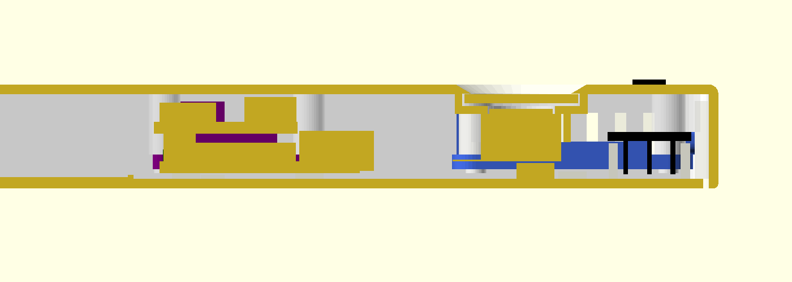
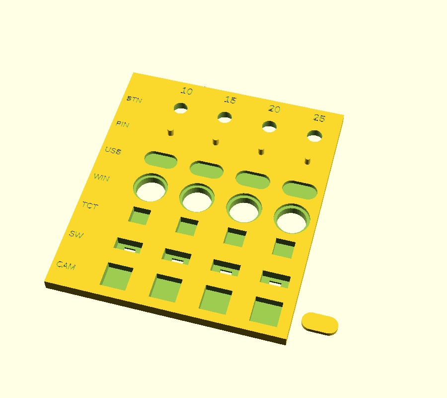

# Thin desk power bank: enclosure (OpenSCAD)

**Bottom line**
- **Outer size:** **175.7 × 54.1 × 11.0 mm** for version 2 (rounded), **175.6 × 54.1 × 11.0 mm** for version 1 (sharp). The cell alone is 85 × 50 × 6.3.
- **Thickness:** the XIAO stack sets it, not the cell. The stack is 8.03 mm from the STEP file, plus 0.6 for the solder joints and 0.35 for ribbon and clearance.
- **Length:** the electronics take about 87 mm, as much as the cell bay.
- **Shrinking it:** the options are listed in [Size](#size-and-how-to-make-it-smaller). The biggest single saving is the antenna bay, 13.2 mm.
- **Checks:** OpenSCAD 2021.01 ran here. Every assert and every must-not-touch pair passes in both versions; results are in [Verification](#verification).
- **Unmeasured parts:** the cell, the camera head and the antenna are still parameters. **Measure them before you order.**

| Version 2 (rounded) | Version 1 (sharp) |
|---|---|
|  |  |


Inside of the body (seen from the back, plug removed), section through the lens, plug, fit coupon:






Files

| File | What |
|---|---|
| `enclosure/powerbank.scad` | The model. Parameters at the top, one module per part |
| `enclosure/tools/run_checks.sh` | Runs the asserts, all intersection pairs and the part renders |
| `enclosure/tools/stl_volume.py` | Volume of an STL. An intersection with < 0.001 mm³ counts as touching only |
| `tools/*.py` | How the STEP, Eagle and DXF files were measured (`pip install cadquery-ocp ezdxf`) |
| `reference/XIAO_ESP32S3_Sense.step` | Your STEP file, copied from the upload. It was not in the repo |
| `reference/measurements.txt` | Raw measurement output that the tables below are taken from |

Exporting (you export the STLs yourself):

```
openscad -o body.stl        -D 'part="body"'        -D 'style="rounded"' enclosure/powerbank.scad
openscad -o plug.stl        -D 'part="plug"'        enclosure/powerbank.scad
openscad -o usb_cover_A.stl -D 'part="usb_cover_A"' enclosure/powerbank.scad   # also _B and _C
openscad -o button_cap.stl  -D 'part="button_cap"'  enclosure/powerbank.scad
openscad -o coupon.stl      -D 'part="coupon"'      enclosure/powerbank.scad
```
Views: `assembled`, `exploded`, `section` (cut through the lens) and `debug` (intersections). Switches: `style` (`sharp` or `rounded`), `charge_port` (`edge` or `front`), `plug_mode` (`permanent` or `removable`), `has_button`, `antenna_place` (`bay`, `over_cell` or `none`), `board_connectors` (`kept` or `removed`), `vents`, `show_lanes`.

---

## 1. Checked dimensions

Confidence levels: **confirmed** = two independent sources agree, or a manufacturer CAD/board file. **single** = one source. **assumed** = no source found; the value is a marked parameter.

| Dimension | Used | Source | Confidence |
|---|---|---|---|
| Cell 635085 T × W × L | 6.3 × 50 × 85 (±5 %) | [Tempero listing](https://temperosystems.com.au/?p=35057). Only seen in the search snippet: a direct fetch returned HTTP 403 | single |
| Cell corner radius, length of the lead end | 0.5, 5.0 zone | none | **assumed** |
| bq25185 PCB | **31.75 × 25.40** × 1.57, corners r 2.54 | [Eagle rev B1](https://github.com/adafruit/Adafruit-bq25185-Charger-Breakout-PCB) and [Adafruit STEP](https://github.com/adafruit/Adafruit_CAD_Parts/tree/main/6091%20bq25185%20USB%20Charger) | confirmed |
| bq25185 USB-C shell | 8.94 × 3.21, r 1.25. Overhangs the board edge by **0.986** | Adafruit STEP (CUI CUSB31-CFM2AX-01-X) | single (CAD) |
| bq25185 holes | 4 × Ø2.5 at (2.54, 2.54), (29.21, 2.54), (2.54, 22.86), (29.21, 22.86) | Eagle | confirmed |
| bq25185 JST-PH height above the PCB | **5.6** | [product page](https://www.adafruit.com/product/6091): 7.2 total. [JLCPCB S2B-PH-SM4-TB](https://jlcpcb.com/partdetail/JST-S2B_PH_SM4_TB_LF_SN/C295747): 5.5 | confirmed (2 sources) |
| MAX17048 PCB | **25.40 × 20.32** × 1.57, r 2.54 | [Eagle](https://github.com/adafruit/Adafruit-MAX17048-PCB) and [Adafruit STEP](https://github.com/adafruit/Adafruit_CAD_Parts/tree/main/5580%20MAX17048) | confirmed |
| MAX17048 holes | **4 holes**: Ø2.5 at (2.54, 2.54) and (22.86, 2.54), Ø2.54 at (2.54, 17.78) and (22.86, 17.78) | Eagle, product photo | confirmed |
| MAX17048 STEMMA QT height | 2.96 above the PCB | Adafruit STEP | single (CAD) |
| XIAO PCB | **21.14** × 17.78 × 1.25 | [Seeed dimension DXF](https://files.seeedstudio.com/wiki/SeeedStudio-XIAO-ESP32S3/res/XIAO_ESP32S3_v1.1_Dimensioning.dxf): 21.135 × 17.78. STEP: 20.955 × 17.78. [Wiki](https://wiki.seeedstudio.com/xiao_esp32s3_getting_started): 21 × 17.8 | confirmed (larger value used) |
| XIAO USB-C | 7.90 deep × 8.94 wide, top 4.46 above the PCB back, **1.527** past the PCB end | STEP | single (CAD) |
| Expansion board PCB | 14.68 × 16.78 (STEP); 15.37 × 17.78 (Seeed v1.0 DXF) | STEP / [DXF](https://files.seeedstudio.com/wiki/SeeedStudio-XIAO-ESP32S3/res/XIAO_ESP32S3_ExpBoard_v1.0_top.dxf) | **conflict**: modelled as the full XIAO width, extending 0.6 past the far end |
| XIAO + expansion stack, no card | **8.03** (PCB back to the microSD socket top) | STEP | single (CAD) |
| Same, with card | 8.50 | STEP (card model) | single (CAD) |
| Camera FPC connector (AFC01-S24) | 6.0 × 16.2 × 2.01, top 7.43 above the PCB back | STEP | single (CAD) |
| OV5640 head (default) | **8.5 × 8.5 ±0.2**, height 5.5 (block 5.0 + barrel 0.5), FPC 6 wide, 70.5 long | [Seeed OV5640 AF spec](https://files.seeedstudio.com/wiki/SeeedStudio-XIAO-ESP32S3/new-res/OV5640_Camera_Module_Specification.pdf) | single (vendor drawing) |
| Your wide-angle AF head | none | none | **assumed: parameter, measure** |
| SS-12D00 body / handle / travel / pitch | 8.8 × 3.9 × 3.5 / 1.5 × 1.5 / 2.0 / 2.5 | [Sofng drawing](https://atta.szlcsc.com/upload/public/pdf/source/20240529/1037A069FE9BBCECE56007AB916D4384.pdf) | single (drawing) |
| SS-12D00-G3 handle height | 3.0 above the body | retailer listings ("3 mm handle") | single |
| SS-12D00 pin length | 3.5 | none (not dimensioned) | **assumed** |
| Tact switch 6 × 6, body 3.5, plunger Ø3.5, travel 0.25 | as listed | Omron B3F distributor pages ([Farnell](https://uk.farnell.com/omron/b3f-1000/switch-spno-0-05a-24v-tht-0-98n/dp/176432), [LCSC](https://www.lcsc.com/product-detail/C93157.html)) | single |
| FPC antenna | 39 × 19 | [one forum report](https://forum.core-electronics.com.au/t/seeed-studio-xiao-esp32s3-sense-ss113991115/23335) | **assumed** |
| USB-C cable overmold the well must accept | 12.35 × 6.5 (well 12.4 × 6.6) | nothing authoritative found | **assumed: measure your cable** |
| 9000HE: tolerance ±0.2 (< 100) / ±0.3 % (> 100), wall > 0.8, HDT 60 °C, Tg 61-68 °C | as listed | [JLC3DP](https://jlc3dp.com/help/article/9000he-resin) | single (vendor) |

### Numbers that differ from yours by more than 0.3 mm
| Item | You | Found | Used |
|---|---|---|---|
| bq25185 width | 26.3 | **25.40** PCB. Your 26.3 includes the USB-C overhang (25.40 + 0.986) | 25.40 + overhang |
| bq25185 / MAX17048 height | 7.2 | 7.2 (product page) and 5.5 + 1.57 = 7.07 (distributor). Adafruit's own STEP shows 6.37 (JST 4.8) | 7.17 (connector 5.6) |
| Camera head | 8 × 8 × 2.1, barrel Ø6.55 × 3.66 | That head in the STEP is the **old stock camera, not an OV5640**: block 8.0 × 8.0 × 2.10, barrel **Ø7.85** at the base, then Ø6.32, then Ø6.0. Seeed's OV5640 is an **AF module, 8.5 × 8.5, 5.0-5.5 tall** | Seeed OV5640 AF values |
| XIAO + expansion stack | ~8 | 8.03 (socket top). 8.50 with a card | 8.03 (you chose no card) |
| MAX17048 holes | none | **4** | posts with pins |

### Your assumptions, checked
- **7.2 mm = the connectors?** Yes. The JST-PH headers are the tallest parts on both boards. **Without connectors**: the bq25185 is **4.77** tall (its USB-C, which stays) and the MAX17048 is **2.37** (0603 parts).
- **Is the standard OV5640 head the same as an aftermarket wide-angle AF module?** No. The STEP head isn't an OV5640 at all. Seeed's own OV5640 is an AF module, 8.5 × 8.5 × 5.5. Wide-angle lenses on AF modules are often larger, and the field of view decides the size of the window opening. All of these are parameters: `cam_w`, `cam_d`, `cam_block_h`, `cam_barrel_d`, `cam_barrel_h`, `cam_aperture_d`, `cam_fov`.
- **Is a 635085 from another seller the same size?** Not guaranteed. The name encodes thickness, width and length, but the seller's ±5 % allows 6.6 × 52.5 × 89.3, and whether the 85 includes the protection board varies. Measure the real cell.
- **The Sense now ships with an OV5640 AF or an OV3660** (Seeed wiki), not the camera in your 2023 STEP file.
- **The XIAO has no on-board antenna.** It needs the U.FL antenna (you chose to reserve a pocket).
- **The XIAO gets hot.** Seeed measured **63.6 °C** on the back during camera use without a heat sink, at 27 °C ambient. That is **above the resin's 60 °C HDT.** See [Heat](#heat-and-cell-safety).

### How the STEP file was measured (and the coordinate mapping)
`tools/stepbb.py` reads the STEP file with OpenCascade (XCAF) and walks the assembly tree, applying each placement. It prints the exact bounding box of every part in the file's global frame. `stepsolids.py` lists solids and cylinder radii, and `slice.py` cuts planes through a part. The raw output is in `reference/measurements.txt`.
- **STEP frame:** x runs along the board, with the USB-C at +x (PCB x −8.673…12.282). y is the stack axis (XIAO PCB back at y = −0.250, top 1.000). z runs across the board (−15.001…2.779).
- **Local frame (u, v, w):** `u = 12.282 − x`, `v = z + 15.001`, `w = y + 0.250`. That is u from the USB-end PCB edge, v across, w up from the PCB back.
- **Enclosure:** `X = Xx0 + u`, `Y = Yx0 + v`, `Z = Zx + w`. The STEP → enclosure rotation (x→−X, z→Y, y→Z) has determinant +1, so it is a proper rotation, not a mirror. The XIAO's USB-C points into the case (−X), toward the row gap, where it needs no access.

---

## 2. Layout concept

From the charging end (X = 0) to the far end. Front face = +Z, back plug = Z 0.

1. **Row 1, at the end wall.**
   - **bq25185**, flat, components up. Its USB-C sits in the end wall in a flush-cover well. Its JST-PH ports face into the row gap.
   - **Small-parts column** beside it, all hung from the front wall: **slide switch** nearest the end, **button** in the corner, **camera head** behind its window.
2. **Row gap**, 8 mm. Room for the mated JST plugs, and for the camera ribbon's S-fold.
3. **Row 2.**
   - **MAX17048**, flat, JST ports facing the bay.
   - **Lane B**, 6 mm: the QT cable, the battery jumper, the NTC wires and the XIAO's wires.
   - **XIAO stack**, flat, expansion board up. Its own USB-C points into the gap.
   - **Lane A**, 2.7 mm, along the wall.
   - The camera ribbon leaves the XIAO connector over the socket. It crosses the gap straight into the camera head's port. The head is aligned with the connector (Y 41.5) to keep the run short: about 38 mm used, about 27-32 mm spare to fold.
4. **Bay**, 21.2 mm.
   - The **antenna** lies flat on the plug in a locating frame.
   - Nothing metal lies over the antenna except the MAX JST plugs, 2.4 mm above it.
   - The bay doubles as the **thermal buffer** between the charger/XIAO and the cell.
5. **Partition**, 1 mm, full height. A wire **tunnel** at the plug side carries the cell leads and the NTC wires.
6. **Lead zone**, 5 mm: protection board, lead bends, plug.
7. **Cell bay.**
   - The cell rests on two **rails** (1.5 mm) on the plug.
   - The **NTC** sits flat in a seat between the rails, flush with the rail tops, so it touches the cell without pressing.
   - Its wires run in the channel between the rails. A foam pad above the cell is optional.

Wires (all assumed): cell leads, LOAD and switch 24-26 AWG silicone, Ø1.2. Button, I2C and NTC extension 28-30 AWG, Ø0.8. NTC leads Ø0.5. Every lane is the bundle plus ≥ 1.0 mm. `lanes()` holds them, and the checks confirm that no printed material enters them.

Front face: switch slot with fingernail scoop at (7.3, 36.5), button Ø5.5 at (6.4, 46.6), lens opening Ø10.4 inside → Ø13.9 outside at (20.8, 41.5). The USB-C well is on the end face at Y 17.1, Z 5.2.

---

## 3. Size, and how to make it smaller

| Build | L × W × T (mm) |
|---|---|
| **Version 2, rounded (default)** | **175.7 × 54.1 × 11.0** |
| **Version 1, sharp** | **175.6 × 54.1 × 11.0** |
| Cell alone | 85 × 50 × 6.3 |
| Cell plus margins and walls only | 88.2 × 53.2 × 9.3 |

**What sets each dimension** (interior heights, mm):
- XIAO stack **8.98**. The cell (rails, cell, swell, tolerance) needs 8.80, the switch 8.80, the MAX and bq 8.37, the tact switch 8.45, the camera 8.10.
- The width comes from row 2: 0.2 + 25.4 (MAX) + 6.0 (lane B) + 17.78 (XIAO) + 2.7 (lane A) = 52.08 inside. The cell needs only 51.2.

**Charging port on the front face: what it costs.** The receptacle points along the board, so the board has to stand on edge with its 25.4 mm depth through the thickness.

| Front USB-C | T |
|---|---|
| connectors kept: the JST plugs then point into the back too | **37.1 mm** (+26.1) |
| connectors removed | **29.3 mm** (+18.3) |
| edge port (default) | 11.0 mm |

With `charge_port="front"` the length drops by 2.5 mm, because the end-wall well goes away.

**Ways to shrink it.** The first rows are model-derived: run them with `-D`.

| Change | Size | Saving | Cost |
|---|---|---|---|
| `antenna_place="over_cell"` | 162.5 × 54.1 × 11.0 | −13.2 L | Antenna sits about 1.2 mm above the pouch's metal foil, so expect weaker RF |
| `board_connectors="removed"` (desolder the JST-PH and QT, solder wires) | 173.7 × 54.1 × 11.0 | −2.0 L | No unplugging. The gap stays 6 mm for the ribbon fold |
| both of the above | **155.5 × 54.1 × 11.0** | −20.2 L | both |
| `has_button=false` | 175.7 × 54.1 × 11.0 | 0 | the button never drives the size |
| corner_r 3 / 5 / 6 / 8 | 175.6 / 176.0 / 176.3 × 54.6 / 177.5 × 55.8 | — | the rounded corners eat into the cell corners. Up to r 5 only the length grows |
| **Stack the MAX on the bq** (connectors removed), move the XIAO beside the bq, move switch, button and camera over the bay | ~147 × ~58 × 11 | −28 L, +4 W | **estimate, not modelled.** MAX 2.37 tall + 0.5 gap over the bq's low parts fits under 9 mm |
| Power the XIAO without the solder joints under the BAT pads | −0.6 T | | electronics decision, yours |
| Thinner cell or a different XIAO stack | | | the stack, not the cell, sets T. A thicker cell (up to about 6.5 + 0.8 swell) costs no extra thickness |

---

## 4. Fits and tolerances

Rule: a printed pocket around a bought part gets **0.10 per side**. With the pocket printed 0.2 small, the worst case is line contact, not interference. Glued fits add a 0.05 epoxy film. Printed-in-printed fits get 0.20 per side, (0.2 + 0.2)/2. Holes use ±0.3. Dimensions > 100 mm use ±0.3 %. **Drift** (0.15-0.2 over 3-7 days) is not added to the nominal fits; it shifts the worst cases below by up to another 0.2, which is why the coupon is there.

| Fit | Nominal | Worst min / max per side | Variable |
|---|---|---|---|
| Camera head in cradle | 8.9 pocket for an 8.5 ±0.2 head | 0 / 0.40 | `fit_slide_bought` |
| Window disc in recess (glue) | Ø12.4 for Ø12.0 ±0.1 | 0 / 0.40 | `fit_glue_bought` |
| Slide-switch body | 9.2 × 4.3 for 8.8 × 3.9 (+0.2 assumed) | 0 / 0.30 | `fit_slide_bought`, `sw_tol` |
| Switch handle slot | 4.1 × 2.1 for 1.5 handle, 2.0 travel | 0.15 / 0.45 (width); travel worst 2.3 | `tol_hole` |
| Tact pocket (glue) | 6.5 for 6.0 (+0.2) | 0.05 / 0.35 | `fit_glue_bought` |
| Button cap Ø5.0 in Ø5.5 bore, flange Ø7.0 in Ø7.4 | | 0 / 0.50 | `fit_pp_hole` / `fit_pp_slide` |
| Board pins Ø2.2 in Ø2.5 PCB holes (±0.08 drilled) | | 0.01 / 0.29 | `fit_pin_pcb` |
| USB-C cover core in well | 12.0 × 6.2 in 12.4 × 6.6 | 0 / 0.40 | `cover_core_fit` |
| Cover crush ribs A / B / C | +0.05 / +0.10 / +0.15 interference | A −0.15…+0.25, B −0.10…+0.30, C −0.05…+0.35 | `cover_rib_interf` |
| Bottom plug, permanent: X (L 173.7 → ±0.52) / Y | 0.57 / 0.25 | X 0.05 / 1.09, Y 0.05 / 0.45 | `plug_fx`, `plug_fy` |
| Bottom plug, removable | X 0.52, Y 0.20 + ribs 0.08 | ribs −0.12…+0.28 interference | `plug_rib_interf` |
| Hold-down pads (XIAO, boards, camera, switch, tact) | 0.20 short | 0 / 0.40 | `pad_float` |
| XIAO stack under the front wall | 0.20 (ribbon 0.15 on top) | 0 / 0.40 | `clr_z` |
| Lens to window disc | 0.60 | 0.40 / 0.80 | `cam_plate_t`, `win_recess_extra` |
| Button cap to tact plunger (never pressed by itself) | 0.20 | 0 / 0.40 | `btn_gap` |
| Swell room above the cell (6.3 nominal) | 1.18 | 0.98. **0.68 if the cell is +5 % (6.6)** | `cell_swell` |
| Cell length / width margin | 1.33 / 2.08 | ≥ 1.13 / ≥ 1.88 | `cell_margin_*` |

The plug seam at the two ends can be up to 1.1 mm wide in the worst case. That is the ±0.3 % rule on 174 mm. Parts from one print job usually scale together, so expect less. Fill it with epoxy and sand flush.

**Fit coupon** (`part="coupon"`, 82 × 95 × 4.3). Each row is the real recess at **0.10 / 0.15 / 0.20 / 0.25** per side, with the number engraved:
- camera pocket
- switch pocket with slot
- tact pocket
- window recess
- USB well (a plain cover core is included)
- PCB pins (try them in the board holes)
- button bore with counterbore

Print it first, wait a week (drift), and pick the tightest one that fits. Then set `fit_slide_bought`, `fit_glue_bought`, `cover_core_fit` and `fit_pin_pcb`.

---

## 5. Enclosure features

- **USB-C cover.**
  - A flush stadium plug in a 1.5 mm well, sized to the overmold.
  - The receptacle face sits 0.21 mm behind the well floor, so the cable seats fully.
  - Three fits, A/B/C. The letter is engraved inside, and each cover has 6 crush ribs with a lead-in.
  - A fingernail scoop at the +Y end lets you lift it out.
  - **Measure your cable's overmold.** If it is larger than 12.4 × 6.6 the plug won't seat. Raise `usb_well_w` / `usb_well_h`.
- **Window.**
  - The disc is glued from inside against a 0.8 mm lip of the front wall and held by a ring.
  - A 0.8 mm stop plate keeps the barrel 0.6 mm behind the disc.
  - The opening is conical, Ø10.4 → Ø13.9, as large as the 12 mm disc allows. It clears a **133° diagonal FOV** for a 3 mm aperture. An assert fails if `cam_fov` is larger: then raise `win_d`.
  - **Buy: Ø12.0 × 1.0 mm clear acrylic (PMMA) or glass disc.** Ø14 × 1.0 also fits the ring (raise `win_d`).
  - A clear printed window (JLC clear resin, polished) would work optically, but expect haze and yellowing. The design doesn't depend on it; 9000HE is opaque.
- **Bottom plug.**
  - `permanent`: a 0.05 epoxy film plus tolerance; it rests on ledges and on the partition.
  - `removable`: crush ribs on the long edges, and a pry notch at the far end.
  - **With the permanent plug the cell can't be inspected or replaced after assembly.**
- **Switch.** The handle tip stands 0.5 above the face in a 0.8 deep fingernail scoop, so 1.3 mm of handle is exposed. Travel 2.0. A 2.5 mm boss (`sw_boss_t`) carries the slot.
- **Button.** A printed cap with a flange that can't fall out, 0.2 above the plunger and 0.4 proud. The tact switch is glued into its pocket, and a backstop on the plug takes the press force. The cap needs the legs **trimmed to ≤ 1.8 mm**. Height check: 4.3 and 5 fit in 11.0 mm. **6 / 7 / 8 make the body 11.45 / 12.45 / 13.45 thick** (the model grows by itself).
- **Antenna.** A 0.4 mm frame on the plug in the bay. `over_cell` puts a frame on the front wall above the cell instead.
- **Vents.** 1.2 × 5 slots in the side walls beside the charger and beside the XIAO (`vents=false` turns them off).
- **Walls.** 1.0 everywhere, 0.8 worst case. Plug 1.0.

## Heat and cell safety
- **Charger.** At the default 1 A charge rate, the linear bq25185 dissipates about 1.3 W at 3.7 V and up to about 2 W near empty (estimate, (5 V − Vbat) × 1 A). In this box that is the main heat source. **Electronics decision for you:** the board's IS jumper sets 500 mA, which halves the heat. Measure with a thermocouple on the first charge. I have not modelled the temperatures.
- **XIAO.** Seeed measured **63.6 °C** on the back during camera use without a heat sink. **That is above the resin's 60 °C HDT.** The enclosure only touches it at 4 end posts and 2 pads, and the vents sit beside it. Duty-cycling the camera or adding a heat sink is your call. The OV5640 also runs warm.
- **Separation.** The charger and XIAO are at least 25 mm from the cell (bay + partition + lead zone), and there is a 1.5 mm air gap under the cell.
- **Cell.** Swell room 1.18 nominal. The cell is located only by round posts at its sealed side edges and by the walls (≥ 1 mm away). Nothing presses on its faces: the rails carry it, and their edges are chamfered. A soft foam pad above it (≤ 1 mm) is optional.

---

## Verification

Run by me here, with OpenSCAD 2021.01 (`apt-get install openscad` worked):

| Check | Result |
|---|---|
| `assert()` pass, 25 asserts, every configuration below | PASS, no warnings |
| 47 must-not-touch pairs, `part="debug"`, CGAL intersection each, rounded | **47 / 47 PASS** |
| same, sharp | **47 / 47 PASS** |
| same: removable plug, connectors removed + antenna over cell, front port, no button (sharp), tact 8 mm + SD card | see `tools/run_checks.sh` output below |
| Every printable part renders as a simple (manifold) solid | PASS |

Pairs cover:
- body and plug against every component dummy, the wire lanes and the plug keep-outs
- the swollen cell (+0.8) against body and antenna
- the NTC wire channel
- component against component
- camera against window, and cap against tact

"Touch" results have 0.000 mm³: designed contacts such as shoulder on PCB, plug on ledge, cap flange under the wall. Run them yourself with `enclosure/tools/run_checks.sh -D 'style="sharp"'` etc.

**What this proves:** with the dimensions in the table, nothing overlaps, and the clearances computed in the asserts hold at worst-case ±0.2.

**Not verified:**
- The real cell, camera head, switch pins, antenna and cable overmold (all unmeasured).
- Thermal behaviour.
- Glue strength.
- Whether the ribbon S-fold lies flat.
- RF performance.
- The front-port variant is modelled and checked for collisions, but its board-on-edge guides are basic.
- Fit is only proven against my dummies. **Don't treat it as proof of fit until the coupon and the real parts agree.**

## Measure with calipers before ordering
1. **Cell:** thickness at the centre and at the seals, width, length *with and without* the protection board, where the leads exit, lead length → `cell_*`, `cell_head_zone`.
2. **Camera head:** block width × depth, block height including the back foam, barrel Ø and height above the block, clear-glass Ø, where the FPC exits, FPC width and length, and the FOV from the listing → `cam_*`.
3. **XIAO stack:** PCB back to the highest point of the socket → `xiao_stack_h`. Also the BAT-pad solder joint height → `xiao_solder_gap`.
4. **Slide switch:** body height, handle height above the body, pin length → `sw_*`.
5. **Tact switch:** total height, body size → `tact_h`.
6. **Antenna:** length × width × thickness, cable length → `ant_*`.
7. **USB-C cable overmold:** width × height → `usb_well_*`.
8. **The two Adafruit boards:** total height with connectors, and that the 25.4 / 20.32 outlines and hole positions match.
9. **Window disc:** diameter and thickness → `win_d`, `win_t`.

## Assumptions (all are parameters)
- **Cell:** pouch corner r 0.5. Lead end needs 5 mm. The 85 includes the protection board. ±5 % tolerance per the listing.
- **Camera:** Seeed OV5640 AF dimensions until you measure the aftermarket one. 120° diagonal FOV, 3 mm clear aperture.
- **Switch:** tolerance +0.2. Pins 3.5 long. G3 = 3.0 handle above the body.
- **Button:** 6 × 6 × 3.5 body, Ø3.5 plunger, legs trimmed to ≤ 1.8, 4.3-5 mm height by default.
- **Wires:** Ø1.2 power, Ø0.8 signal, Ø0.5 NTC leads. Mated JST-PH plug plus bend needs 8 mm; QT needs 6 mm.
- **NTC:** flat 4 × 2.5 × 1.0 type, taped to the cell.
- **Antenna:** 39 × 19 × 0.2.
- **USB-C overmold:** ≤ 12.4 × 6.6.
- **XIAO:** BAT-pad joints kept flat (≤ 0.6 mm) and the wires leave sideways, past the PCB edge.
- **PCB thickness:** 1.57 ±0.15 (front-mode guides).
- **"Bottom plug":** taken to be the back face, the one on the desk, opposite the front with the lens.
