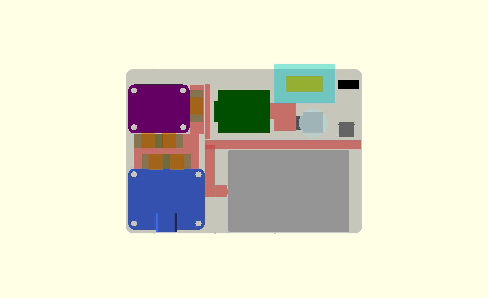
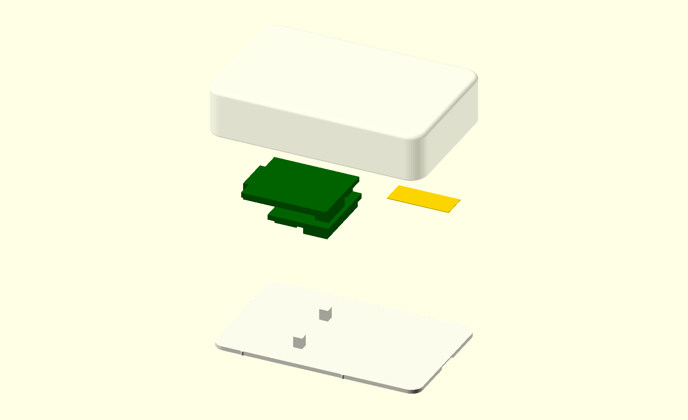
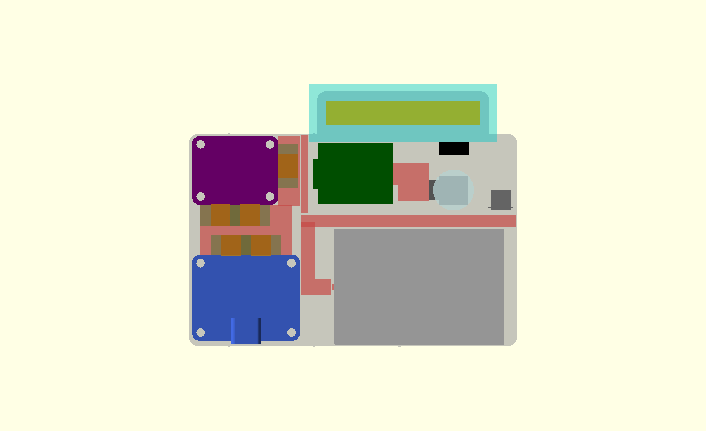
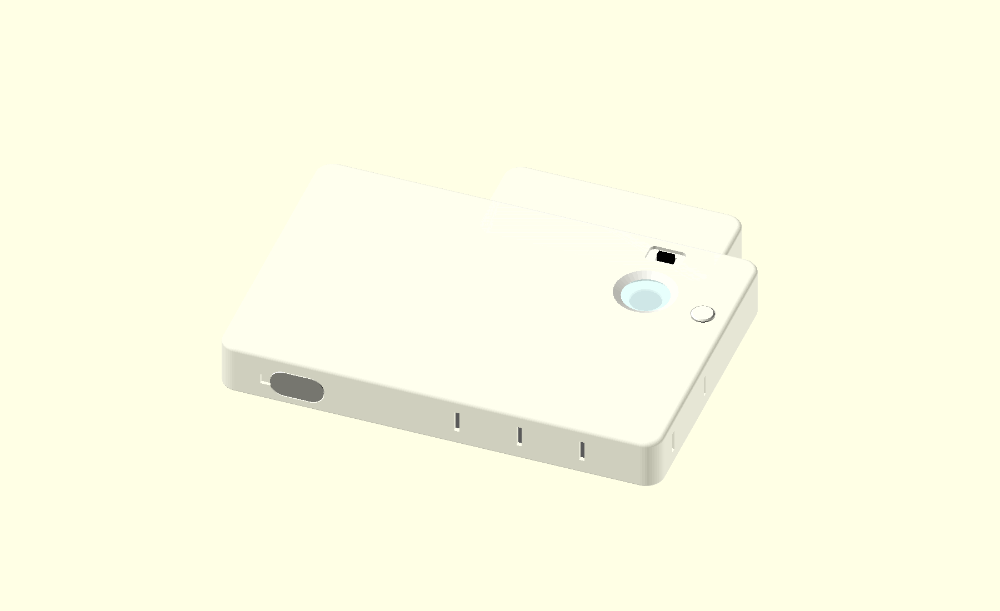
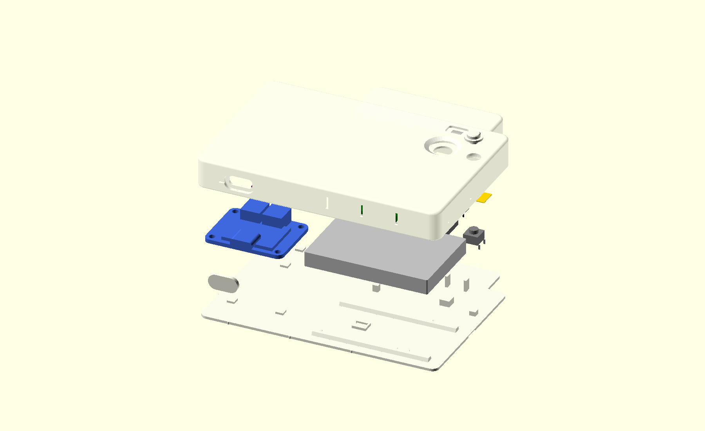
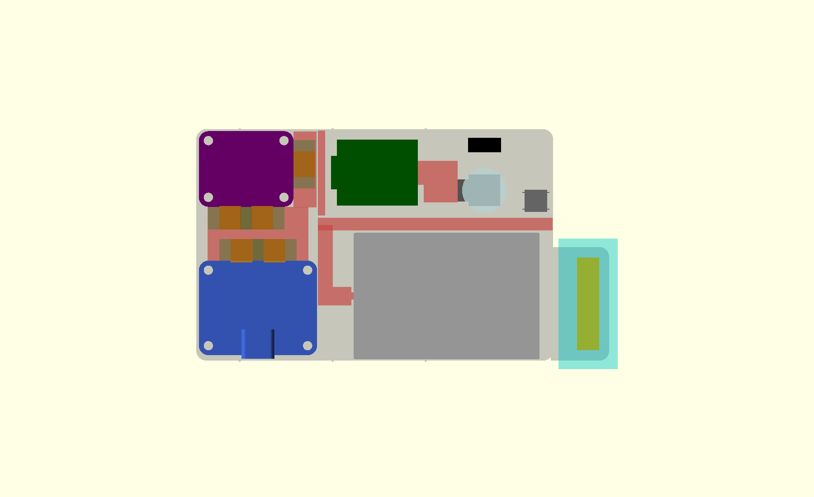
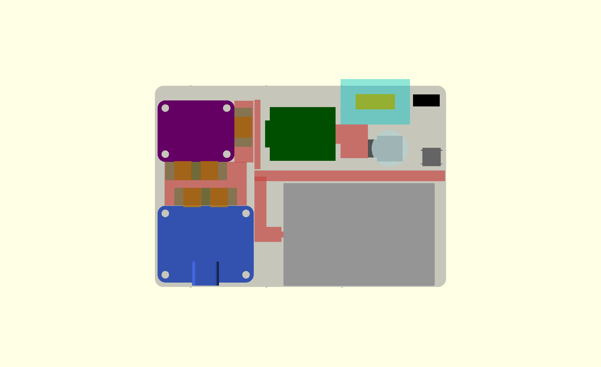
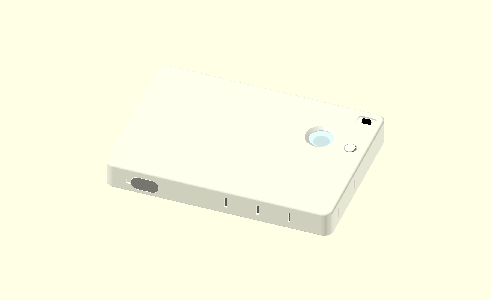
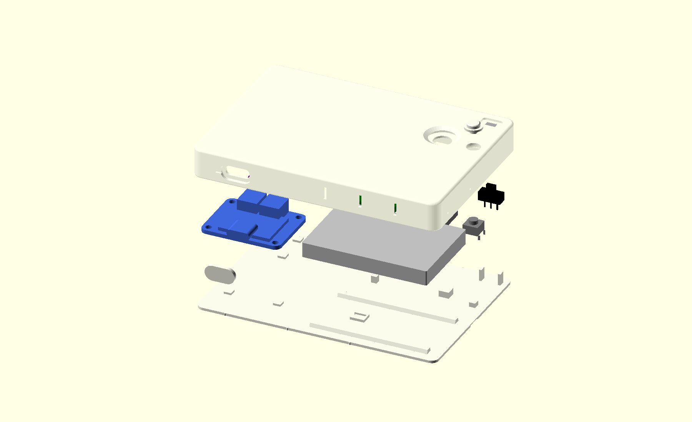

# Thin desk power bank: enclosure (OpenSCAD)

**Two models live here.** The **compact 70 × 100 × 12 mm** version (`powerbank70.scad`, the current request) is first. The **full-capacity** version (635085 cell, `powerbank.scad`, 187.1 mm long) follows from "Full-capacity version" and is unchanged apart from one corrected figure in section 5 (the fit coupon size).

## Compact version: 70 × 100 × 12 mm (`powerbank70.scad`)

**Bottom line: the default build is a 603450-class LiPo (1000–1500 mAh) with a 13 × 5 mm ceramic U.FL antenna inside: 98.60 × 68.96 × 11.78 mm (98.6 × 69.0 × 11.8), a clean rectangle; 98.80 × 69.16 × 11.98 mm worst-case printed.** A stick-on antenna does not fit in 70 × 100 × 12. **Plan B** grows the whole body as a clean rectangle: Molex-206994-class 15.4 × 6.4 mm needs **100.20 × 70.36 × 11.78 mm**, a 25 × 6 mm needs **108.53 × 69.96 × 11.78 mm**; the Molex-class is smaller (see "Plan B"). There is **no tab or bump** in the recommended path. A **Wi-Fi test piece** lets you compare the ceramic and a stick-on antenna in the same bay before you commit.

**Facts (from the model and its logs)**
- **Default build** (603450 cell 6.0 × 34 × 50, ceramic 13 × 5 × 1.0, version 2 rounded): **98.60 × 68.96 × 11.78 mm**. Version 1 (sharp): 97.72 × 68.96 × 11.78. The longest ceramic that still fits is 15 × 5: 99.80 × 68.96. A 10 × 4 antenna gives 98.60 × 67.96.
- **The hard limits are checked at the worst-case printed size** (nominal + JLC ±0.2 mm), not at the nominal size. This is the `limits_at_worst_case` switch. Worst case for the default build: 98.80 × 69.16 × 11.98.
- **All 30 asserts pass and all 98 collision pairs pass (no overlap volume; a few pairs touch face to face at exactly 0.000 mm³, e.g. the antenna on its frame and the plug on the body) in 19 configurations** (14 with the antenna inside the 70 × 100 body, 2 Plan B bodies, 3 for the unused tab code; table under "Files and checks"). Every printable part renders as one simple solid in each.
- Antenna: **24.36 mm from the cell foil** (rule ≥ 10), 5.0 mm keep-out from other metal (rule ≥ 5), 4.39 mm from the plug and from the front wall (default build). Swelling room above the cell at +5 %: **1.98 mm** (rule: 0.8 + 0.2 print tolerance). Button ≤ 6.0 mm is an assert (`tact_h <= 6.0`, strict).
- Every connector keeps its finger columns (3 mm each side, open to the back). The removable plug is the default. Strain relief: printed tie posts at the cell leads and in the bq25185 → MAX17048 gap. Other cables are tacked with adhesive (not modelled).

**Analysis**
- **The length is the binding dimension.** The antenna and the switch share the band above the cell, so each millimetre of antenna length adds 1 mm of outer length, until the camera and button row takes over at 13 mm (98.60). **13 × 5 is therefore the longest ceramic that costs no length**; 15.0 mm is the longest that fits in 100 mm at all (worst case 99.9957, 0.004 mm to spare).
- **Thickness is set by the XIAO stack**, not by the cell: the XIAO gap to the front wall is 1.4 mm (`xiao_wall_gap`). I first had 1.6 mm (T = 11.98), then saw that +0.2 mm of print tolerance would give 12.18 mm, so I cut it to 1.4 mm.
- **Why a stick-on antenna fails with a 603450-class cell:** the cell block runs to 94.2 mm, so the switch and button cannot sit in the free corner beside it and go into the top band, next to the antenna. A 25 mm antenna there pushes the switch to 108.8 mm. A cell ≤ 41.25 mm long (503040 class, 520–620 mAh in listings) frees that corner, and then an antenna ≤ 28.3 × 9.8 mm fits.
- **This is a limit of this one layout, not proof that no arrangement works.** My earlier 2-D packing search found other arrangements for some stick-on cases (cell turned, antenna in a side column). I did not model them, and their cell-lead route would cross the antenna keep-out, so I do not count them.

**What is wrong with this layout (read before ordering)**
1. **The USB-C charging port is on a long (100 mm) edge.** You chose the short edge earlier. The compact layout runs the bq25185 → MAX17048 stack along the 70 mm direction (63.1 mm long) beside the cell block (56.2 mm). Turning it so the port sits on the 70 mm edge puts both along the 100 mm direction: about 1.0 + 63.1 + 4.0 + 56.2 + 1.0 = **125 mm** (arithmetic from the model's numbers, not a simulation). If the long edge is not acceptable, the only options I can see are a smaller cell or a different board stack, which changes the electronics, so I have not done it.
2. **Nothing from Shopee was verified.** Shopee TW returned nothing I could read, and Claude in Chrome is not available in this cloud session. Every size below is a standard code or a listing from another shop found by web search. Treat each as **unverified** until you measure the part.
3. **Wire lanes are reserved boxes, not simulated cables.** The camera ribbon jog (4.76 mm over 9 mm) is not simulated. The antenna cable check is a straight line from the XIAO's U.FL socket to the antenna (9.8 mm minimum for the default); slack is not modelled.
4. **The camera/radar update you sent earlier is still not applied.** There is no radar in this design.
5. **The RCY splice option is not in the compact model.** The cell must be PH, or get a PH pigtail (section 6.3).

### Cell × antenna: outer size and pass / fail

| Cell (T×W×L mm) | mAh in listings (unverified) | ceramic 13×5 (**default**) | ceramic 15×5 | ceramic 10×4 | Molex-class 15.4×6.4 | stick-on 25×6 | stick-on 42×12 | stick-on 45×7 | stick-on 39×19 |
|---|---|---|---|---|---|---|---|---|---|
| 603450 (6.0×34.0×50.0) | 1000–1500 | **PASS**† 98.60 × 68.96 | **PASS**† 99.80 × 68.96 | **PASS**† 98.60 × 67.96 | fail **100.20** × **70.36** | fail **109.80** × 69.96 | fail **126.80** × **75.96** | fail **129.80** × **70.96** | fail **123.80** × **82.96** |
| 603450max (6.0×34.5×52.0) | 1000–1500 | **PASS** 98.60 × 69.46 | **PASS**† 99.80 × 69.46 | **PASS** 98.60 × 68.46 | fail **100.20** × **70.86** | fail **109.80** × **70.46** | fail **126.80** × **76.46** | fail **129.80** × **71.46** | fail **123.80** × **83.46** |
| 503450 (5.0×34.0×50.0) | 950–1200 | **PASS** 98.60 × 68.96 | **PASS**† 99.80 × 68.96 | **PASS** 98.60 × 67.96 | fail **100.20** × **70.36** | fail **109.80** × 69.96 | fail **126.80** × **75.96** | fail **129.80** × **70.96** | fail **123.80** × **82.96** |
| 503450max (5.3×34.8×53.0) | 950–1200 | **PASS** 98.73 × 69.76 | **PASS**† 99.80 × 69.76 | **PASS** 98.73 × 68.76 | fail **100.20** × **71.16** | fail **109.80** × **70.76** | fail **126.80** × **76.76** | fail **129.80** × **71.76** | fail **123.80** × **83.76** |
| 603048 (6.0×30.0×48.0) | 850–950 | **PASS** 98.60 × 64.96 | **PASS**† 99.80 × 64.96 | **PASS** 98.60 × 64.62 | fail **100.20** × 66.36 | fail **109.80** × 65.96 | fail **126.80** × **71.96** | fail **129.80** × 66.96 | fail **123.80** × **78.96** |
| 603048max (6.3×30.5×50.0) | 850–950 | **PASS** 98.60 × 65.46 | **PASS**† 99.80 × 65.46 | **PASS** 98.60 × 64.62 | fail **100.20** × 66.86 | fail **109.80** × 66.46 | fail **126.80** × **72.46** | fail **129.80** × 67.46 | fail **123.80** × **79.46** |
| 503040 (5.0×30.0×40.0) | 520–620 | **PASS** 98.53 × 64.96 | **PASS**† 98.53 × 64.96 | **PASS** 98.53 × 64.62 | **PASS** 98.53 × 66.36 | **PASS**† 98.53 × 65.96 | fail **113.50** × **71.96** | fail **116.50** × 66.96 | fail **110.50** × **78.96** |
| 503040max (5.5×30.5×42.0) | 520–620 | **PASS** 98.60 × 65.46 | **PASS**† 99.80 × 65.46 | **PASS** 98.60 × 64.62 | fail **100.20** × 66.86 | fail **109.80** × 66.46 | fail **126.80** × **72.46** | fail **129.80** × 67.46 | fail **123.80** × **79.46** |

How to read it: each cell shows **nominal L × W in mm** (T = 11.78 for all). **PASS** = every assert passes at the worst-case printed size. **†** = also all 98 collision pairs pass. The Molex-class column is Plan B territory (it needs a body of 100.20 × 70.36, see "Plan B"). "fail" shows the nominal size, with any nominal dimension over 100 or 70 mm in bold (the check itself uses the worst-case printed size, so a "fail" can show no bold number). Rows with "max" use the largest size some listing or datasheet quotes for that code, and "mAh in listings" comes from those listings: **all unverified**. The stick-on and ceramic antenna sizes are typical sizes from web search results, not Shopee.

Sources for the cell sizes and capacities (web search, not Shopee): [603450 listings](https://besomi.com/ae_en/bcbx0175-lithium-polymer-battery-pack-37v-1000mah-rechargeable.html) (1000 / 1200 / 1500 mAh, some say 6.0 × 34.5 × 52 max), [503450](https://www.eemb.com/product-138) (EEMB bare cell 950 mAh, 34.5 × 52 × 5.3), [503040](https://www.digikey.dk/en/products/detail/jauch-quartz/LP503040JH-PCM-2-WIRES-50MM/13540153) (600 mAh, 30.5 × 42 × 5.4), [603048](https://www.eemb.com/product-146) (850–950 mAh).

### Recommendation

1. **Cell: 603450 (6.0 × 34 × 50), 1000–1200 mAh.** Same footprint as the 503450 but more capacity (1000–1500 mAh listings against 950–1200) and 1.98 mm of swelling room. Choose a listing that states a built-in protection circuit and a JST-PH plug.
2. **Antenna: ceramic, 13 × 5 mm or shorter, inside the body** (the default build, 98.60 × 68.96 × 11.78). 15.0 mm is the hard limit. It sits at mid-height on a printed frame, 24 mm from the foil.
3. **Print version 1 (sharp) if you need more room**: it is 0.88 mm shorter (97.72 mm), because the rounded body keeps the bq25185 away from its 3 mm corner radius.
4. **Before anything else, print the fit coupon and the Wi-Fi test piece** (below). If a stick-on antenna wins by a margin worth the size, use Plan B with the Molex-class antenna (100.20 × 70.36). The antenna sits 5 mm from metal, as you required, but that is geometry, not measured RF performance.

### Plan B: grow the whole body as a clean rectangle

No tab, no bump: the whole body gets longer and wider so that a stick-on antenna sits inside it, with **every antenna rule kept**: 5.0 mm from other metal, 24.36 mm from the cell foil (rule 10), 3 mm from the side walls and 4.8 mm from the plug and the front wall, all verified by the collision pairs. I tried both orientations and both switch layouts (switch and button in the band above the cell, or in the corner beside it) and kept the smallest.

| Antenna (603450 cell) | Version 2 (rounded) | Version 1 (sharp) | Switch and button |
|---|---|---|---|
| **Molex-206994-class 15.4 × 6.4 × 0.15** | **100.196 × 70.360 × 11.78 mm** (worst case printed 100.50 × 70.56 × 11.98), 7050 mm² | 99.317 × 70.360 × 11.78 (99.52 × 70.56), 6988 mm² | band above the cell |
| **Stick-on 25 × 6 × 0.2** | **108.529 × 69.960 × 11.78 mm** (108.85 × 70.16 × 11.98), 7593 mm² | 107.650 × 69.960 × 11.78 (107.97 × 70.16), 7531 mm² | corner beside the cell |
| For reference: default ceramic 13 × 5 | 98.596 × 68.960 × 11.78 (98.80 × 69.16), 6799 mm² | 97.717 × 68.960 | band above the cell |

**The Molex-class antenna is the smaller: 7050 against 7593 mm² (−543 mm², −7 %), 8.33 mm shorter and 0.40 mm wider than the 25 × 6.** Against the default it costs +1.60 mm of length and +1.40 mm of width. It does **not** fit your 70 × 100: it is 0.20 mm too long (version 1 sharp is 0.68 mm under on length) and **0.36 mm too wide in both versions**. The 25 × 6 is 8.5 mm over on length.

To build it, raise the limits to the worst-case printed size, rounded up (the smalls layout is set explicitly because the automatic rule follows `max_L`):
```
openscad -o body.stl -D 'part="body"' -D 'ant_type="stick"' -D ant_l=15.4 -D ant_w=6.4 -D ant_t=0.15 -D 'smalls_place="band"'   -D max_L=101 -D max_W=71 powerbank70.scad
openscad -o body.stl -D 'part="body"' -D 'ant_type="stick"' -D ant_l=25   -D ant_w=6   -D ant_t=0.2  -D 'smalls_place="corner"' -D max_L=109 -D max_W=71 powerbank70.scad
```
The full table of the four tries per antenna and style is in `enclosure/check_results/c70_planB_study.txt` (`python3 enclosure/tools/run_planb.py`). Both Plan B bodies pass all 98 pairs (`c70_planB_*.log`). **Not verified:** the Molex part's size and gain come from distributor pages, not a datasheet I could open (section "Unused: antenna tab study" has the sources); neither Plan B body was printed.



### Wi-Fi test piece

**What it is.** A small closed box cut out of the real body around the XIAO and the antenna bay: **53.87 × 34.16 × 11.78 mm** with a 51.47 × 32.32 mm lid (`part="wifi_test"` and `part="wifi_test_plug"`). It has the real walls (1.0 mm), the real XIAO posts and hold-down pads, the real antenna frame at the real distances (XIAO block 5.0 mm away, 4.8 mm from the lid and the front wall), and a 12.4 × 6.6 mm opening in the left wall for the XIAO's USB-C cable. It has no cell, boards, camera or switch.

**One bay, two antennas.** In both builds the antenna sits in the same slot (5 mm right of the XIAO block, 5 mm above the camera and ribbon); only the body around it differs. So the piece has **one bay, sized for the Molex-class stick-on (15.4 × 6.4 mm), and the 13 × 5 ceramic goes in the same frame at the XIAO-side corner**. Everything is identical except the antenna. The ceramic then sits 5.4 mm from the right wall and 4.4 mm from the top wall, against 3.0 mm in the real default build: Seeed's advice is 3–5 mm, so this is slightly kinder to the ceramic.

| | |
|---|---|
|  | Shell and lid (exploded), with the XIAO (green) and the antenna (gold). |

**How to use it** (same method as section 7.3, 3 m, 120 s, median and 10th-percentile RSSI)
1. Print `stl/c70_wifi_test.stl` (shell) and `stl/c70_wifi_test_plug.stl` (lid, removable ribs).
2. Seat the XIAO on its posts, USB-C cable out through the left wall, lid on.
3. **Run A: ceramic 13 × 5** in the frame, U.FL cable to the XIAO. **Run B: the stick-on** (Molex-class or any ≤ 15.4 × 6.4 mm) in the same frame. Same XIAO, same table, same access point, same USB cable position. Alternate A, B, A, B, A, B.
4. **Decision:** the antenna with the higher median wins; if the order of the two medians swaps between pairs of runs, there is no difference to claim. Only a clear stick-on win is worth the Plan B size.

**What it does not test:** the cell foil (24 mm away in the real build), the slide switch (5 mm from the antenna in the band layout), the camera, the wiring and the permanent plug. Power comes over USB, so the cable is in the picture for both runs. Run the full device test of section 7.3 for the antenna you pick. The piece is not printed yet.

### Unused: antenna tab study (kept for reference)

**Status: UNUSED.** You ruled out any tab or bump: the outer shape must be a clean rectangle. The tab code stays in `powerbank70.scad` (`ant_place`, marked unused) and still passes its checks, but **nothing in this section is a recommendation**; Plan B (above) replaced it. The default is `ant_place="inside"`.

**Question.** The antenna must stay fully inside the case. The main body stays at 70 × 100 × 12 mm. A separate tab (up to 12 mm thick) may sit on one end. How much extra length or width does each stick-on antenna need with the 603450 cell, keeping the 5 mm keep-out from metal and 10 mm from the cell foil? The ceramic antenna inside the body was the default.

**Answer**
- **Smallest tab for every stick-on size: on the +Y (70 mm) side, directly above the XIAO.** Extra width: **25 × 6 +5.68 mm, 45 × 7 +7.20 mm, 40 × 8 +8.20 mm** (all within 10 mm); **42 × 12 +12.20 mm and 39 × 19 +19.20 mm fail**.
- **Best tab for at most 10 mm extra: 45 × 7 on the +Y tab: 98.60 × 77.20 × 11.78 mm total.** It is the longest of the five sizes inside the budget, and it needs less than the 40 × 8 (+8.20) because it is narrower. The 25 × 6 needs 1.5 mm less (+5.68) if you want the smallest tab.
- **The far (+X) end does not help, and overlaps nothing.** Every size needs at least **+13.63 mm of length** there, decided by the 10 mm cell-foil rule, so all five fail the 10 mm budget.
- **Baseline, 13 × 5 mm ceramic inside the body: 98.60 × 68.96 × 11.78 mm, no extra.** Any stick-on antenna costs 5.7–8.2 mm more than that, at best.
- If the 10 mm must be **length** only, the only pass is growing the whole body for the 25 × 6 (+8.53 mm: 108.53 × 69.96, worst case printed 108.86). No +X tab passes.

| Antenna | Tab on the +Y side (smallest) | Tab on the +X far end (smallest) | Body grown, no tab |
|---|---|---|---|
| ceramic 13x5 (**baseline**) | **PASS** 98.60 × 74.68 (+4.68 W) | **PASS** 108.10 × 64.68 (+8.10 L) | **PASS** 98.60 × 68.96 (+0.00 L) |
| stick 25x6 | **PASS** 98.60 × 75.68 (+5.68 W) | fail 113.63 × 64.68 (+13.63 L) | **PASS** 108.53 × 69.96 (+8.53 L) |
| stick 40x8 | **PASS** 98.60 × 78.20 (+8.20 W) | fail 115.63 × 64.68 (+15.63 L) | fail 111.50 × 71.96 (+11.50 L) |
| stick 42x12 | fail 98.60 × 82.20 (+12.20 W) | fail 119.63 × 64.68 (+19.63 L) | fail 113.50 × 75.96 (+13.50 L) |
| stick 45x7 | **PASS** 98.60 × 77.20 (+7.20 W) | fail 114.63 × 64.68 (+14.63 L) | fail 116.50 × 70.96 (+16.50 L) |
| stick 39x19 | fail 98.60 × 89.20 (+19.20 W) | fail 126.63 × 64.68 (+26.63 L) | fail 110.50 × 82.96 (+12.96 W) |
| Linx SH 25.4x20.1 (datasheet) | fail 98.60 × 89.78 (+19.78 W) | fail 127.73 × 64.68 (+27.73 L) | fail 108.53 × 84.06 (+14.06 W) |
| Molex 206994 15.4x6.4 (datasheet) | **PASS** 98.60 × 76.08 (+6.08 W) | fail 110.50 × 64.68 (+10.50 L) | **PASS** 100.20 × 70.36 (+0.36 W) |

Each cell: **total outer L × W in mm** (T = 11.78 for all), and the extra over 100 × 70 in brackets. PASS = every assert passes at the worst-case printed size, with the main body ≤ 100 × 70 × 12 and the tab adding ≤ 10 mm (`tab_budget`). "Body grown" lets the whole body extend instead of building a tab, judged against the same 10 mm; the switch and button are tried both in the band above the cell and in the corner beside it. The two datasheet rows are real parts, not your sizes (below). Full output for every orientation: `enclosure/check_results/c70_tab_study.txt`; rerun with `python3 enclosure/tools/run_tab_study.py` (add `--all` for every orientation, edit `ANTENNAS` for real parts).

**Where the tab goes (45 × 7).** Antenna box x 41.5–86.5, y 66.2–73.2 (outer coordinates), so the tab is 53 mm wide and sticks out 12.5 mm past the main body (x 37.5–90.5, to y = 77.2). The antenna is **5.0 mm above the slide switch** (which decides the position), 5.5 mm above the XIAO board, **30.6 mm from the cell foil** and 4.79 mm from the plug and the front wall. The straight line from the XIAO's U.FL socket to the antenna is 9.8 mm.

| Layout, antenna in a +Y tab | The same, assembled |
|---|---|
|  |  |



**Far end.** Placing the tab at the +X end, beyond the cell, leaves the antenna beside the cell foil. The foil ends at x = 93.63, so the antenna must start at x ≥ 103.63: **+13.63 mm (25 × 6 turned 90°), +14.63 (45 × 7), +15.63 (40 × 8)**, and more for the wide ones. Nothing overlaps there: all 93 pairs pass, including the 11 new tab-cavity pairs (`c70_tab_x_far_end_*.log`). The cable has to be at least 46–53 mm for the far end, against about 10 mm for the +Y tab.



**How the tab is built.** The tab has the body's thickness (11.78 mm, below your 12 mm), shares the main cavity (the wall opens where the tab joins), and the plug has a matching lobe. The antenna hangs at mid-height on the printed frame, 3 mm from the tab's walls. In tab builds the slide switch moves above the camera, so the main body is 98.60 × 64.68 mm.

**How the position is found.** The model scans the edge in 0.5 mm steps against every metal part (the cell foil at 10 mm, the bq25185, MAX17048, JST plug zones, XIAO board, camera, switch, button and wire lanes at 5 mm) and takes the smallest tab. The CGAL pair checks then verify it. `ant_tab_pos` overrides the scan.

**RF evidence.** None of your five sizes matches a datasheet part I could find, so I cannot rank them by gain. Two real parts, for reference: the [Linx ANT-2.4-FPC-SH](https://cdn.sparkfun.com/assets/9/0/e/2/f/ant-2_4-fpc-sh-ds.pdf) is 25.4 × 20.1 × 0.1 mm with 85 % efficiency and 4.0 dBi peak gain, measured on a 2 mm plastic sheet, and needs +19.78 mm here (fail). The [Molex 206994](https://www.everythingrf.com/products/all-antennas/molex/741-363-206994-0100) is 15.4 × 6.4 × 0.15 mm, about 3.6 dBi and over 55 % efficiency (a distributor figure; one listing disagrees on the lowest frequency), and fits with +6.08 mm in a tab or +0.2 mm in length inside. So size does not decide efficiency, and **45 × 7 was a geometric choice, not an RF ranking**. Only the range test in section 7 can decide.

**Limits of the tab model**
- The tab is full thickness. A thinner tab would need a stepped plug, which I did not model; "as small as possible" is the footprint.
- The plug's friction ribs sit on the main body's edges only. The tab lobe has 0.2 mm clearance and no ribs, so a removable plug needs a strip of tape or a drop of adhesive there.
- The cable is a straight-line lower bound, not a routed cable. The coax has to cross the opening in the main wall above the XIAO.
- The tab was not printed and the antenna's RF behaviour was not measured.

### FPC antenna on the inner surface of the lid or a wall (50 × 14 × 0.3 mm): FAIL in 70 × 100 × 12

**Test.** A flexible adhesive FPC antenna, 50 × 14 × 0.3 mm, U.FL, lying flat on the INNER surface of the lid, the front wall or a side wall instead of in the board layer, optionally bent once around an edge (R3 mm, gentle). Every distance is checked in 3D against the real extents of each metal part: **10 mm from the cell foil, 5 mm from every other metal part, board and wire lane** (`tools/run_fpc_inner.py`; output in `check_results/c70_fpc_inner_r3.txt` and `_r5.txt`). The layout is the one with the antenna out of the board layer (switch above the camera, body 98.60 × 64.68). Ceramic 13 × 5 stays the fallback and the default.

**Result: FAIL.** No flat or once-bent placement of a 50 × 14 strip clears the metal inside 98.6–99.8 × 69.8 (the worst-case-printed 100 × 70).
- **Flat on the lid or the front wall: no 50 × 14 patch is free.** The lid and front wall are covered by the cell block (foil needs 10 mm), the two boards, the XIAO and the wire lanes. Every position touches a wire lane or a part (margin −5.0 mm at best, i.e. contact).
- **Bent along the +Y wall (the best case): short by 2.9 mm at 69.8 wide.** The strip's 14 mm width is 6.5 mm on the wall, a 3 mm bend and 2.8 mm on the lid or front wall, along x 39–89. The **slide switch** (5 mm rule) blocks it. With the switch moved away, the **XIAO** blocks it: its board edge is 5 mm (3D) from the strip's flat part, so the +Y wall must be at least 72.55 mm out.
- **Along the −X wall:** the bq25185 board sits 0.9 mm from the wall. **Along the +X wall:** the cell foil is 4 mm away and needs 10 (−9.0 mm). **Along the −Y wall:** the cell foil is 0.6 mm away (−10.0 mm).
- **The 12 mm height does not help:** every part is nearly cavity-tall (cell 6.0 mm on 1.5 mm rails, boards and XIAO stack 8–9 mm), so the 3D distance is about the plan distance.

**Smallest body that works** (the +X and +Y walls move out, nothing else moves; R3 bend; the answer for R5 is 1–2 mm bigger):

| Body | Over 70 × 100 | Where the antenna goes |
|---|---|---|
| **98.6 × 73.2 × 11.78** | +3.2 mm width | along the +Y wall, x 41–91: 6.5 mm on the wall, R3 bend, 2.8 mm on the front wall or lid |
| 110.6 × 64.7 × 11.78 (smaller area, 7153 mm²) | +10.6 mm length | along the +X wall, y 1–51: same bend, 6.5 mm on the wall |

Neither fits 70 × 100. Compare with Plan B: the Molex-class antenna needs 100.20 × 70.36 and is far smaller. **Not modelled in the 3D model:** the bend itself, the strip's attachment and the plastic posts and ledges it would have to avoid; this is a clearance calculation. The camera on the short end face, one tact button on that face and no vents or slots were not applied (that message was not in my conversation); an end-face camera would also take the +X or −X wall.

### Parameters to change when you have real parts

All are at the top of `powerbank70.scad`, in the section `PARTS YOU SWAP`. Change the numbers, run `openscad -o out.echo powerbank70.scad`, and the asserts name the dimension that fails. **The layout recomputes itself; nothing is moved by hand.**

| Part | Parameters | Enter |
|---|---|---|
| Cell | `cell_code` (label), `cell_t`, `cell_w`, `cell_l`, `cell_lead_len`, `cell_tol_pct` | The listing's **maximum** thickness, width and length (the pocket adds 1.2 mm on length and width). `cell_lead_len` = wire length to the PH plug. Swelling is checked at `cell_t` × (1 + `cell_tol_pct`) |
| Antenna | `ant_type` (`"ceramic"` or `"stick"`), `ant_l`, `ant_w`, `ant_t`, `ant_cable_len` | Body size. Cable length from the listing (must be ≥ the straight-line distance the assert reports) |
| Slide switch | `sw_l`, `sw_w`, `sw_h`, `sw_handle`, `sw_handle_h`, `sw_travel`, `sw_pin_l` | Body length along the slide, body width, body height, handle width, handle height above the body, travel, pin length |
| Button | `tact_w`, `tact_body_h`, `tact_h`, `tact_act_d` | `tact_h` = total height to the top of the plunger, **≤ 6.0** (assert) |
| Antenna tab (**UNUSED**) and Plan B | `ant_place`, `ant_rot`, `ant_tab_pos`, `tab_budget`, `smalls_place`, `max_L`, `max_W` | `ant_place="tab_y"` puts the antenna in a tab on the +Y side, `"tab_x"` on the +X end, `"inside"` (default) in the body. `ant_rot=90` turns the antenna. `ant_tab_pos=-1` finds the smallest tab by itself. `tab_budget` = most the tab may add (10). `smalls_place` forces the switch and button into the `"corner"` or the `"band"` above the cell. **Plan B** = raise `max_L` / `max_W` and set `smalls_place` (see "Plan B"). The tab options are unused |
| Model switches | `limits_at_worst_case`, `enforce_limits`, `style`, `plug_mode` | `limits_at_worst_case=false` checks nominal sizes only. `enforce_limits=false` shows the size of a layout that does not fit |

To test many candidates at once, add lines to `CELLS` and `ANTENNAS` in `enclosure/tools/run_combos.sh` and run it. It prints the outer size and the first assert that fails. `run_combos.sh full` also runs the collision pairs for every combination that passes.

### Shopping spec (what to search for on Shopee)

**Use the all-at-once envelope** (the default build is the 13 × 5 ceramic; the envelope allows up to 15.0 × 5.4 × 3.5): every part at its limit together, tested with all 93 pairs (envelope row of the checks table). Cell **≤ 6.9 × 34.2 × 54.0 mm** · ceramic antenna **≤ 15.0 × 5.4 × 3.5 mm** · slide-switch body **≤ 8.8 × 6.0 mm**, pin + body + handle **≤ 10.7 mm** · button **≤ 6.0 mm** tall.

The table also gives the larger limit each dimension has **on its own** (all other parts at default). Those larger limits share budgets, so they cannot all be used at once: **cell width + antenna width ≤ 39.8 mm** (fitted from 7 runs), and the switch height is one total. If a listing is outside the envelope but inside a single-part limit, put its numbers into the file and read the asserts.

| Part | Size window that still fits | Connector | Protection / electrical |
|---|---|---|---|
| **LiPo cell** (1S, 3.7 V nominal, 4.2 V max) | Use the listing's **maximum** figures: **thickness ≤ 6.9 mm, width ≤ 34.2 mm (34.8 mm alone), length ≤ 54.0 mm**. Codes that fit: 603450 and 503450 (the 1000–1500 mAh class); 603048 (850–950 mAh) and 503040 (520–620 mAh) fit too but are below your range | **JST-PH 2.0 mm, 2-pin.** If it is XH, 1.25 mm or RCY, cut it off and solder on a PH pigtail (section 6.3). **Check polarity with a multimeter** before the first plug-in. **Leads ≥ 62.3 mm** (the model needs 61.7–62.2 mm); listings quote 50–150 mm, so a 50 mm lead needs a pigtail | **A built-in protection circuit (PCM) stated in the listing**: overcharge, over-discharge, over-current and short-circuit cut-offs. Seller pages for 603450 cells quote about 4.28 V, 2.5 V and 2.5–4 A, but those are not datasheets: get the real values from the seller. A bare cell with solder tabs does not qualify. The [bq25185 board](https://www.adafruit.com/product/6091) charges at **1 A by default** (cut its jumper for 500 or 250 mA), so with a 1000 mAh cell choose one rated for a 1C charge or cut the jumper. Prefer 2 wires: a 3rd wire is an NTC whose value you must measure |
| **Ceramic antenna** (2.4 GHz, 50 Ω) | **Default: 13 × 5 mm.** Body **length ≤ 15.0 mm (hard limit; 13 mm is the longest that costs no length: 98.60 mm), width ≤ 5.4 mm (5.8 mm alone), thickness ≤ 3.5 mm (3.77 mm alone)**. With a ≤ 48 mm × 30 mm cell (603048 class) width can be up to 9.8 mm | **U.FL, also sold as IPEX gen-1 or MHF1.** Seeed's wiki names the XIAO socket U.FL-R-SMT1. **Reject MHF4, IPEX 4 and W.FL**: they do not mate. Cable **≥ 10 mm** by the model's straight-line lower bound; a 50 mm pigtail is realistic. A 100 mm cable leaves about 70 mm of slack that has no modelled place | Efficiency and gain are not checked by the model. Only the range test decides |
| **Stick-on antenna** | **Not inside 70 × 100 × 12 with a 603450 cell.** Plan B (whole body grows, clean rectangle): **Molex-206994-class, 15.4 × 6.4 × ≤ 0.2 mm → 100.20 × 70.36 mm** (the smaller); **25 × 6 mm → 108.53 × 69.96 mm**. Longer or wider ones are larger still (matrix above). Inside the body only with a 503040-class cell ≤ 41.25 mm long: length ≤ 28.3 mm, width ≤ 9.8 mm (each on its own; the tested combination is 25 × 6 mm) | U.FL, as above | As above |
| **Slide switch** | Body **length ≤ 8.8 mm, width ≤ 6.0 mm (6.3 mm alone)**. Height: **pin length + body height + handle height ≤ 10.7 mm** in total (10.98 mm alone; the default is 3.5 + 3.5 + 3.0 = 10.0). Enter them as `sw_pin_l`, `sw_h`, `sw_handle_h` | Through-hole pins, soldered. No connector | Rating is not modelled. Pick one rated for the cell's current |
| **Button** | **6 × 6 mm** tact, **total height to the top of the plunger ≤ 6.0 mm** (your rule; the file asserts it). Defaults: body 3.5 mm, plunger Ø 3.5 mm | Through-hole or SMD pins, soldered | None |
| **JST-PH pigtail** (only if the cell plug is not PH) | n/a: it joins the cell leads | **PH 2.0 mm, 2-pin, pre-crimped. Wire AWG 24–30** (PH housings take no thicker wire), length ≥ 100 mm to trim | None |

When you have Shopee links, send them. I will put the numbers into the `PARTS YOU SWAP` section, rerun the asserts and the collision pairs, and report pass or fail for each combination.

### Layout (default build, seen from the front, body hidden)



Colours: silver = cell, royal blue = bq25185 (USB-C on the bottom edge), purple = MAX17048, dark green = XIAO + expansion board, grey ring = camera, light cyan disc = window, black = slide switch, grey square = button, gold = antenna, cyan box = antenna keep-out, orange = plug zones, green = finger columns, red = reserved wire lanes.

| Assembled | Exploded |
|---|---|
|  |  |

### Files and checks for the compact version

| File | What |
|---|---|
| `enclosure/powerbank70.scad` | The compact model, one standalone file (no includes). Swap-in parameters at the top. Built from the full model's modules |
| `enclosure/tools/run_combos.sh` | Cell × antenna table (`full` adds the collision pairs) |
| `enclosure/tools/run_checks.sh` | Asserts + pairs + part renders. `SCAD=powerbank70.scad enclosure/tools/run_checks.sh` for the compact model |
| `enclosure/stl/c70_*.stl` | STLs for the default build (ceramic 13 × 5): body v2 / v1, plug (removable and permanent), covers A / B / C, button cap, fit coupon |
| `enclosure/stl/c70_tab_*.stl` | **Unused.** The tab build (45 × 7 on the +Y side): body v2 / v1 (98.60 × 77.20 × 11.78), plug v2 removable / permanent, plug v1 removable. Covers, button cap and coupon are the default ones |
| `enclosure/stl/c70_wifi_test.stl`, `c70_wifi_test_plug.stl` | **The Wi-Fi test piece**: shell and lid, bay sized for the Molex-class antenna (also holds the 13 × 5 ceramic) |
| `enclosure/tools/run_fpc_inner.py` | Test of a flat FPC antenna on the inner surface of the lid or a wall (3D clearances, smallest body) |
| `enclosure/tools/run_planb.py` | Plan B study: both orientations and both switch layouts, smallest outer size per antenna |
| `enclosure/check_results/c70_planB_study.txt` | Output of the Plan B study, both styles |
| `enclosure/tools/run_tab_study.py` | (Unused) the antenna tab study: every antenna, inside / +X tab / +Y tab, total size and pass or fail |
| `enclosure/check_results/c70_tab_study.txt` | Output of the tab study for every orientation |
| `enclosure/check_results/c70_*.log` | One log per configuration (asserts, 93 pairs, part renders) |
| `enclosure/check_results/c70_combos_table.txt` | Output of `run_combos.sh`: every cell × antenna combination, with the first failing assert |
| `enclosure/check_results/c70_size_limits.txt` | Where the shopping-spec size windows come from: the largest value of each parameter that still passes, one at a time, others at default |

**Checks run by me here (OpenSCAD 2021.01), on the final `powerbank70.scad`**

| Configuration | Asserts | Collision pairs | Printable parts (9) |
|---|---|---|---|
| **Default:** 603450 + ceramic 13×5 inside, v2 rounded, removable plug | PASS | **98 / 98** | one simple solid each |
| Default, v1 sharp, removable plug | PASS | **98 / 98** | one simple solid each |
| Default, v2 rounded, permanent plug | PASS | **98 / 98** | one simple solid each |
| 603450 + ceramic 15×5 (the longest that fits) | PASS | **98 / 98** | one simple solid each |
| 603450 at listing max 6.0×34.5×52.0 + ceramic 15×5 | PASS | **98 / 98** | one simple solid each |
| 503450 5.0×34.0×50.0 + ceramic 15×5 | PASS | **98 / 98** | one simple solid each |
| 503450 at listing max 5.3×34.8×53.0 + ceramic 15×5 | PASS | **98 / 98** | one simple solid each |
| 603048 6.0×30.0×48.0 + ceramic 15×5 | PASS | **98 / 98** | one simple solid each |
| 603048 at max 6.3×30.5×50.0 + ceramic 15×5 | PASS | **98 / 98** | one simple solid each |
| 503040 5.0×30.0×40.0 + ceramic 15×5 | PASS | **98 / 98** | one simple solid each |
| 503040 at max 5.5×30.5×42.0 + ceramic 15×5 | PASS | **98 / 98** | one simple solid each |
| 503040 5.0×30.0×40.0 + stick-on 25×6 | PASS | **98 / 98** | one simple solid each |
| 603450 + ceramic 10×4 | PASS | **98 / 98** | one simple solid each |
| **All-at-once envelope** (shopping spec): cell 6.9×34.2×54.0, ceramic 15.0×5.4×3.5, switch 8.8×6.0 with stack 10.7, button 6.0 | PASS | **98 / 98** | one simple solid each |
| **Plan B:** Molex-class 15.4×6.4 (switch in the band), limits raised to 101 × 71: 100.196 × 70.360 | PASS | **98 / 98** | one simple solid each |
| **Plan B:** stick-on 25×6 (switch in the corner), limits raised to 109 × 71: 108.529 × 69.960 | PASS | **98 / 98** | one simple solid each |
| Unused tab code: +Y tab, 45×7, v2 rounded, removable plug | PASS | **98 / 98** | one simple solid each |
| Unused tab code: +Y tab, 25×6 | PASS | **98 / 98** | one simple solid each |
| Unused tab code: far (+X) end, 25×6 turned 90° | PASS | **98 / 98** | one simple solid each |

The 98 pairs are: body and plug against every part, lane and plug zone (0–26); part against part (27–47); the 5 mm antenna keep-out against every metal part, lane and zone (48–57); the 10 mm antenna-to-cell zone and the hot zones against the swollen cell (58–59); every finger-access column against the body, cell, boards, camera, switch, button, antenna and cap (60–69); every wire lane against the cell, boards, camera, switch and button (70–76); the plug zones against the boards, XIAO, camera and cell (77–81); the inside space of the unused antenna tab against the other parts (82–92, empty when there is no tab); **new: the Wi-Fi test piece shell and lid against the XIAO, the antenna and each other (93–97)**. The nine printable parts are body, plug, three USB covers, button cap, coupon, Wi-Fi test shell and Wi-Fi test lid. The coupon is 3 volumes by design (2 solids). Logs: `enclosure/check_results/c70_*.log`.

**Not verified for the compact version:** everything under "What is wrong with this layout" above, plus: the real cell, its connector, lead length and protection board; the camera head; the antenna's RF performance; the slide switch and button sizes (defaults come from the SS-12D00G3 drawing and a typical 6 × 6 tact switch); and thermal behaviour. **Fit is proven only against my dummies.**

---

## Full-capacity version (635085 cell, `powerbank.scad`)

**Bottom line: 187.1 × 54.1 × 11.0 mm (version 2, rounded) or 187.0 × 54.1 × 11.0 mm (version 1, sharp), with JST-PH on every board connection and the antenna ≥ 5 mm from all metal.**
- **Length is 1.8 mm shorter than the last round (188.9)**, because the plug zones now use the real JST-PH housing sizes. Thickness and width are unchanged.
- **Your cell's connector: I could not check it.** You haven't bought the cell, and the one listing I have never confirmed a connector for me. If it turns out not to be JST-PH, the cheapest fix costs **0 mm**: cut its plug off and solder on a JST-PH pigtail. Keeping your red RCY plug as a splice costs **+5.0 mm** (on edge, 192.1 mm long) or **+7.7 mm** (flat, 194.8 mm). Details are in [section 6](#6-connectors-cell-jst-ph-and-the-red-rcy-pairs).
- **Wi-Fi:** the antenna now hangs on a frame **4.4 mm from the front wall and from the plug** (Seeed staff advise 3–5 mm from plastic), 5.0 mm from the nearest metal and 10.6 mm from the cell foil. A range test with a pass/fail threshold is in [section 7](#7-wi-fi-review-and-range-test). I have not measured any RF.
- **Sealing for good: I would not do it on the first build.** The XIAO's USB-C is internal (no way to reflash), the cell can't be inspected, and the XIAO's back now sits 0.6 mm under a wall that is rated 60 °C. See [section 8](#8-permanent-build-review).
- **Checks: 81 / 81 pairs pass** in every configuration listed in [Verification](#verification). The new wire-lane-against-component pairs found that **my earlier cell-lead route did not exist**; it is corrected below.
- **STLs** are in `enclosure/stl/`. The camera/radar update you sent earlier was interrupted and is **not applied**; there is no radar in this design.

| Version 2 (rounded) | Version 1 (sharp) |
|---|---|
|  |  |

Layout seen from the front, body hidden. The colours are the dummies, the plug zones (orange), the finger-access columns (green) and the antenna keep-out (cyan):


The same view with `cell_connector="RCY"`: the red box is the splice, with its finger columns (green) in the 10 mm lead zone:


Inside of the body (seen from the back, plug removed): the antenna bay with its two fences and frame, and the posts. Then the plug:


Files

| File | What |
|---|---|
| `enclosure/powerbank.scad` | The model (layout 3). Parameters at the top, one module per part |
| `enclosure/stl/` | Exported STLs, see the list below |
| `enclosure/layout_studies.scad` | Placement models of layouts 1 and 2, used for the comparison table |
| `enclosure/tools/run_checks.sh` | Runs the asserts, all 81 intersection pairs and the part renders |
| `enclosure/tools/run_studies.sh` | Runs the 42 placement checks for each of layouts 1 and 2 |
| `enclosure/tools/stl_volume.py` | Volume of an STL. An intersection with < 0.001 mm³ counts as touching only |
| `enclosure/check_results/` | Check output |
| `enclosure/img/` | Preview renders |
| `tools/*.py` | How the STEP, Eagle and DXF files were measured (`pip install cadquery-ocp ezdxf`) |
| `reference/XIAO_ESP32S3_Sense.step` | Your STEP file, copied from the upload |
| `reference/measurements.txt` | Raw measurement output |

STLs in `enclosure/stl/` (all render as single manifold solids):

| File | Part |
|---|---|
| `body_v2_rounded.stl`, `body_v1_sharp.stl` | Body (tray), version 2 / version 1 |
| `plug_v2_rounded.stl`, `plug_v1_sharp.stl` | Bottom plug, permanent (epoxy) |
| `plug_v2_rounded_removable.stl`, `plug_v1_sharp_removable.stl` | Bottom plug, removable (crush ribs). Use this while developing |
| `usb_cover_A.stl`, `_B`, `_C` | Charging-port cover, three fits |
| `button_cap.stl` | Button cap (prints head down) |
| `fit_coupon.stl` | Fit coupon. Print it first |
| `body_v2_rounded_rcy_edge.stl`, `plug_v2_rounded_rcy_edge.stl`, `plug_v2_rounded_rcy_edge_removable.stl` | **Only if your cell has the red RCY plug and you keep it as a splice** (192.1 mm long). Others: `-D cell_connector=\"RCY\"` |

To re-export after changing a parameter:

```
openscad -o body.stl -D 'part="body"' -D 'style="rounded"' enclosure/powerbank.scad   # part = body | plug | usb_cover_A/B/C | button_cap | coupon
```
- **Views:** `assembled`, `exploded`, `section` (cut through the lens), `layout` (no body, with zones and keep-out), `debug` (intersections).
- **Switches:** `style`, `charge_port`, `plug_mode`, `has_button`, `antenna_place` (`bay` or `none`), `board_connectors`, `vents`, `show_lanes`.

---

## 1. Checked dimensions

Confidence levels: **confirmed** = two independent sources agree, or a manufacturer CAD/board file. **single** = one source. **assumed** = no source found; the value is a marked parameter.

| Dimension | Used | Source | Confidence |
|---|---|---|---|
| Cell 635085 T × W × L | 6.3 × 50 × 85 (±5 %) | [Tempero listing](https://temperosystems.com.au/?p=35057). Only seen in the search snippet: a direct fetch returned HTTP 403 | single |
| Cell corner radius, length of the lead end | 0.5, 5.0 zone | none | **assumed** |
| bq25185 PCB | **31.75 × 25.40** × 1.57, corners r 2.54 | [Eagle rev B1](https://github.com/adafruit/Adafruit-bq25185-Charger-Breakout-PCB) and [Adafruit STEP](https://github.com/adafruit/Adafruit_CAD_Parts/tree/main/6091%20bq25185%20USB%20Charger) | confirmed |
| bq25185 USB-C shell | 8.94 × 3.21, r 1.25. Overhangs the board edge by **0.986** | Adafruit STEP (CUI CUSB31-CFM2AX-01-X) | single (CAD) |
| bq25185 holes | 4 × Ø2.5 at (2.54, 2.54), (29.21, 2.54), (2.54, 22.86), (29.21, 22.86) | Eagle | confirmed |
| bq25185 JST-PH height above the PCB | **5.6** | [product page](https://www.adafruit.com/product/6091): 7.2 total. [JLCPCB S2B-PH-SM4-TB](https://jlcpcb.com/partdetail/JST-S2B_PH_SM4_TB_LF_SN/C295747): 5.5 | confirmed (2 sources) |
| MAX17048 PCB | **25.40 × 20.32** × 1.57, r 2.54 | [Eagle](https://github.com/adafruit/Adafruit-MAX17048-PCB) and [Adafruit STEP](https://github.com/adafruit/Adafruit_CAD_Parts/tree/main/5580%20MAX17048) | confirmed |
| MAX17048 holes | **4 holes**: Ø2.5 at (2.54, 2.54) and (22.86, 2.54), Ø2.54 at (2.54, 17.78) and (22.86, 17.78) | Eagle, product photo | confirmed |
| MAX17048 STEMMA QT height | 2.96 above the PCB | Adafruit STEP | single (CAD) |
| JST PH plug housing PHR-2 | 5.8 wide × 4.5 thick × 6.35 long | [JST PH catalogue](https://static.chipdip.ru/lib/832/DOC031832410.pdf) (mirror; JST's site returned 403) | single (vendor drawing) |
| JST PH side-entry header S2B-PH-SM4-TB | body 6.0 deep (+2.6 tab) × 7.9 wide × 5.5 high | same | confirmed (matches Adafruit's 8.6 long STEP model) |
| JST PH housing protrusion when mated | **about 2.0** | inferred from JST's "8.0 mm high" on a 6.0 mm header | **assumed** |
| PH wire O.D. / minimum bend radius / straight run | 1.2 / 4.8 / 2.0 | O.D. from JST's 0.8-1.5 range; radius and run are mine | **assumed** |
| JST RCY mated pair | 23.3 long × 4.0 thick × 6.7 wide | [JST RCY catalogue](https://static.datasheets.com/doc/22217635-jst-syr-02t-ds.pdf) | confirmed (length and thickness also match your numbers) |
| XIAO PCB | **21.14** × 17.78 × 1.25 | [Seeed dimension DXF](https://files.seeedstudio.com/wiki/SeeedStudio-XIAO-ESP32S3/res/XIAO_ESP32S3_v1.1_Dimensioning.dxf): 21.135 × 17.78. STEP: 20.955 × 17.78. [Wiki](https://wiki.seeedstudio.com/xiao_esp32s3_getting_started): 21 × 17.8 | confirmed (larger value used) |
| XIAO USB-C | 7.90 deep × 8.94 wide, top 4.46 above the PCB back, **1.527** past the PCB end | STEP | single (CAD) |
| Expansion board PCB | 14.68 × 16.78 (STEP); 15.37 × 17.78 (Seeed v1.0 DXF) | STEP / [DXF](https://files.seeedstudio.com/wiki/SeeedStudio-XIAO-ESP32S3/res/XIAO_ESP32S3_ExpBoard_v1.0_top.dxf) | **conflict**: modelled as the full XIAO width, extending 0.6 past the far end |
| XIAO + expansion stack, no card | **8.03** (PCB back to the microSD socket top) | STEP | single (CAD) |
| Same, with card | 8.50 | STEP (card model) | single (CAD) |
| Camera FPC connector (AFC01-S24) | 6.0 × 16.2 × 2.01, top 7.43 above the PCB back | STEP | single (CAD) |
| OV5640 head (default) | **8.5 × 8.5 ±0.2**, height 5.5 (block 5.0 + barrel 0.5), FPC 6 wide, 70.5 long | [Seeed OV5640 AF spec](https://files.seeedstudio.com/wiki/SeeedStudio-XIAO-ESP32S3/new-res/OV5640_Camera_Module_Specification.pdf) | single (vendor drawing) |
| Your wide-angle AF head | none | none | **assumed: parameter, measure** |
| SS-12D00 body / handle / travel / pitch | 8.8 × 3.9 × 3.5 / 1.5 × 1.5 / 2.0 / 2.5 | [Sofng drawing](https://atta.szlcsc.com/upload/public/pdf/source/20240529/1037A069FE9BBCECE56007AB916D4384.pdf) | single (drawing) |
| SS-12D00-G3 handle height | 3.0 above the body | retailer listings ("3 mm handle") | single |
| SS-12D00 pin length | 3.5 | none (not dimensioned) | **assumed** |
| Tact switch 6 × 6, body 3.5, plunger Ø3.5, travel 0.25 | as listed | Omron B3F distributor pages ([Farnell](https://uk.farnell.com/omron/b3f-1000/switch-spno-0-05a-24v-tht-0-98n/dp/176432), [LCSC](https://www.lcsc.com/product-detail/C93157.html)) | single |
| FPC antenna | 39 × 19 | [one forum report](https://forum.core-electronics.com.au/t/seeed-studio-xiao-esp32s3-sense-ss113991115/23335) | **assumed** |
| USB-C cable overmold the well must accept | 12.35 × 6.5 (well 12.4 × 6.6) | nothing authoritative found | **assumed: measure your cable** |
| 9000HE: tolerance ±0.2 (< 100) / ±0.3 % (> 100), wall > 0.8, HDT 60 °C, Tg 61-68 °C | as listed | [JLC3DP](https://jlc3dp.com/help/article/9000he-resin) | single (vendor) |

### Numbers that differ from yours by more than 0.3 mm
| Item | You | Found | Used |
|---|---|---|---|
| bq25185 width | 26.3 | **25.40** PCB. Your 26.3 includes the USB-C overhang (25.40 + 0.986) | 25.40 + overhang |
| bq25185 / MAX17048 height | 7.2 | 7.2 (product page) and 5.5 + 1.57 = 7.07 (distributor). Adafruit's own STEP shows 6.37 (JST 4.8) | 7.17 (connector 5.6) |
| Camera head | 8 × 8 × 2.1, barrel Ø6.55 × 3.66 | That head in the STEP is the **old stock camera, not an OV5640**: block 8.0 × 8.0 × 2.10, barrel **Ø7.85** at the base, then Ø6.32, then Ø6.0. Seeed's OV5640 is an **AF module, 8.5 × 8.5, 5.0-5.5 tall** | Seeed OV5640 AF values |
| XIAO + expansion stack | ~8 | 8.03 (socket top). 8.50 with a card | 8.03 (you chose no card) |
| MAX17048 holes | none | **4** | posts with pins |

### Your assumptions, checked
- **7.2 mm = the connectors?** Yes. The JST-PH headers are the tallest parts on both boards. **Without connectors**: the bq25185 is **4.77** tall (its USB-C, which stays) and the MAX17048 is **2.37** (0603 parts).
- **Is the standard OV5640 head the same as an aftermarket wide-angle AF module?** No. The STEP head isn't an OV5640 at all. Seeed's own OV5640 is an AF module, 8.5 × 8.5 × 5.5. Wide-angle lenses on AF modules are often larger, and the field of view decides the size of the window opening. All of these are parameters: `cam_w`, `cam_d`, `cam_block_h`, `cam_barrel_d`, `cam_barrel_h`, `cam_aperture_d`, `cam_fov`.
- **Is a 635085 from another seller the same size?** Not guaranteed. The name encodes thickness, width and length, but the seller's ±5 % allows 6.6 × 52.5 × 89.3, and whether the 85 includes the protection board varies. Measure the real cell.
- **The Sense now ships with an OV5640 AF or an OV3660** (Seeed wiki), not the camera in your 2023 STEP file.
- **The XIAO has no on-board antenna.** It needs the U.FL antenna (you chose to reserve a pocket).
- **The XIAO gets hot.** Seeed measured **63.6 °C** on the back during camera use without a heat sink, at 27 °C ambient. That is **above the resin's 60 °C HDT.** See [Heat](#heat-and-cell-safety).

### How the STEP file was measured (and the coordinate mapping)
`tools/stepbb.py` reads the STEP file with OpenCascade (XCAF) and walks the assembly tree, applying each placement. It prints the exact bounding box of every part in the file's global frame. `stepsolids.py` lists solids and cylinder radii, and `slice.py` cuts planes through a part. The raw output is in `reference/measurements.txt`.
- **STEP frame:** x runs along the board, with the USB-C at +x (PCB x −8.673…12.282). y is the stack axis (XIAO PCB back at y = −0.250, top 1.000). z runs across the board (−15.001…2.779).
- **Local frame (u, v, w):** `u = 12.282 − x`, `v = z + 15.001`, `w = y + 0.250`. That is u from the USB-end PCB edge, v across, w up from the PCB back.
- **Enclosure:** the stack is **flipped** so the camera-FPC latch faces the back opening: `X = Xx0 + u`, `Y = Yx0 + 17.78 − v`, `Z = Zxb − w` (Zxb = PCB back, 0.6 below the front wall). Overall STEP → enclosure is x→−X, z→−Y, y→−Z. That has determinant +1, so it is a proper rotation, not a mirror. The XIAO's USB-C points into the case (−X), toward the row gap, where it needs no access.

---

## 2. Layout concept (layout 3)

From the charging end (X = 0) to the far end. Front face = +Z, back plug = Z 0. All plugs are reached from the back with the plug off.

1. **Row 1, at the end wall.**
   - **bq25185** lies flat. Its USB-C sits in the end wall in a flush-cover well, and its two JST-PH ports face +X.
   - **Small-parts column** beside it: **slide switch**, **button**, **camera head** behind its window. All hang from the front wall.
2. **Row gap, 14.2 mm** (was 16), sized from the real JST-PH housings ([section 6](#6-connectors-cell-jst-ph-and-the-red-rcy-pairs)).
   - Each plug zone is the housing's full travel: 2.0 mm mated plus 4.35 mm of withdrawal. Both housings face each other, and each has its own clear column to the back opening, ±3 mm wider than the housing.
   - The jumper from the MAX17048 to the bq25185 BATT port S-bends 7.0 mm to take up the 3.05 mm sideways offset between the two ports.
   - The camera ribbon crosses the +Y half of the gap and S-folds its spare length there.
3. **Row 2.**
   - **MAX17048**, turned so its JST-PH ports face −X into the gap. Its STEMMA QT faces +Y into lane B (6 mm), with its own access column.
   - **XIAO stack, flipped:** expansion board toward the back opening, so the camera-FPC latch can be reached. The XIAO PCB back faces the front wall with 0.6 mm for the battery-pad joints. **That puts its hottest face 0.6 mm from the wall** (see [section 8](#8-permanent-build-review)).
   - **Lane A** (2.7 mm) along the +Y wall carries the cell leads (stacked) and the XIAO's wires.
4. **Antenna bay, 29 mm** (5 + 19 + 5).
   - The antenna **hangs on a plastic frame at mid-height**, not on the plug: its adhesive back sticks to a 1.5 mm rim and the radiating area sits over an open window. The two fences that carry the frame are 5 mm from the antenna on both ends.
   - **4.4 mm** to the front wall, **4.4 mm** to the plug, **3.0 mm** to the −Y wall. No metal within 5 mm: the cross-bay wire lane is on the +Y side, 5.0 mm beyond the antenna's edge, so no wire crosses it.
   - The bay is also the thermal buffer between the electronics and the cell.
   - The XIAO's U.FL coax is the antenna's own feed, so it is not counted as foreign metal. Put the feed end of the antenna at the +Y end, nearest the XIAO's U.FL socket.
5. **Lead zone**, 5 mm (10 mm with the RCY splice on edge): protection board, lead bends.
6. **Cell bay**, as before: rails, NTC seat, round end stops. New: **8 relief slots** (4 per long wall, 1.2 × 5.0) beside the cell.

**Wiring (every board connection is JST-PH)**
- **Battery:** cell leads → lead zone → **+Y lane across the bay** → lane A → along the row gap in −Y → **MAX17048 JST #2**. This needs **about 134 mm of lead** (model estimate along the lane boxes). If your cell's leads are shorter, solder a longer PH pigtail onto them.
- **Jumper:** MAX17048 JST #1 → bq25185 **BATT**, a PH–PH jumper cable with slack for the 4.35 mm unplugging travel.
- **Power:** bq25185 LOAD (PH) → switch → XIAO BAT pads (soldered). QT cable MAX → XIAO through lane B. NTC → +Y lane → gap → over the bq25185 → TH pad.
- **This replaces the previous route**, which ran the cell leads over the MAX17048. That route did not exist: the MAX's corner posts and its 7.2 mm JST headers leave 0.8 mm below the front wall. I found it when I added the pairs that check the wire lanes against the boards (pairs 67-73): three of my lanes ran through the bq25185, the MAX17048 and the camera head.
- **What "lane" means here:** a reserved box checked against the printed walls, the boards and the parts. **It is not a simulation of cables.** Bend radii and tangling are not simulated.

---

## 3. Size and layout comparison

**The three layouts tried**, all with connectors kept, the access rule and the 5 mm antenna rule:

| Layout | L × W × T (mm) | Volume | Footprint | Rules | Checks | How far it was modelled |
|---|---|---|---|---|---|---|
| **3 · single deck, antenna bay (chosen)** | **187.1 × 54.1 × 11.0** | **111.1 cm³** | 101 cm² | both met | **81 / 81** | full printable model |
| 1 · boards in a deck under the cell | ≥ 117.8 × 54.3 × 20.6 | ≥ 131.6 cm³ | 64 cm² | both met | 42 / 42 (placement) | placement model, lower bound |
| 2 · MAX17048 stacked on bq25185 | ≥ 191.7 × 53.5 × 17.9 | ≥ 183.9 cm³ | 102 cm² | both met | 42 / 42 (placement) | placement model, lower bound |

Layouts 1 and 2 are placement models in `layout_studies.scad`. They hold the measured part models, the walls, the cell, the antenna with its keep-out, the plug zones and the access columns, and they pass their own 42 collision/rule checks. Posts, fences and guides are left out, and **those could only make them bigger**. Since their lower bounds are already larger than layout 3's full printable model, layout 3 is the smallest.


- **Layout 1:**
  - **Pros:** the smallest footprint, 37 % less than layout 3.
  - **Cons:** almost **double the thickness**. The board deck (8.98) and the cell deck (8.8) stack, with a 0.8 mm shelf between.
  - **Also:**
    - The charger sits under the cell with only shelf + air between them, which works against your heat rule.
    - The cell has to go in before a separate shelf part.
    - If desk footprint matters more to you than thickness, this is the layout to detail next.
- **Layout 2:** the MAX17048 has to clear the bq25185's 7.2 mm JST tops, which adds 6.9 mm of thickness. Its plug zone still needs a clear column down to the back opening, so it saves no length either. It is worse on every measure.

**Layout 3 against the first design** (175.7 × 54.1 × 11.0, which broke both rules): **+11.4 mm of length.**

| Change | mm |
|---|---|
| Row gap sized for two facing JST-PH housings (gap 8 → 14.2) | +6.2 |
| Antenna bay to 5 + 19 + 5 (was 21.2 + 1.0 partition) | +6.8 |
| Row 2 ends at the last metal, no post margin | −1.6 |

**What layout 3 trades off**
- **Antenna placement.** The antenna sits in a **middle bay, not an end bay or corner**. **I did not model end-bay layouts**, so this is reasoning, not a comparison:
  - At the charging end, the bq25185 USB-C already needs that end wall.
  - At the far end, the antenna would be more than 100 mm from the XIAO's U.FL socket, and its coax would have to cross the cell bay or run past the cell foil.
  - If you want an end bay modelled, say so.
- **Cell leads must reach about 134 mm** (model value `cell_lead_need`, printed on every run) along the lane route to the MAX17048. Typical pouch-cell lead lengths are shorter and the listing doesn't say, so plan on a longer PH pigtail soldered onto the leads (or the 20 cm RCY leads, see section 6).
- **Wire routing.** The cell leads and NTC wires cross the bay on the +Y side, 5 mm beyond the antenna's edge.
- **Thermal.** The partition is gone: the 29 mm bay is the thermal buffer. The charger is 72 mm from the cell foil and the XIAO 34.6 mm.
- **XIAO flip.** The camera latch is reachable now, but the XIAO's back (battery-pad side) faces the front wall 0.6 mm away.

**What can still not be unplugged** (by the parts' own design, not the enclosure):
- The XIAO's battery wires are soldered (it has no battery connector).
- Its U.FL antenna socket sits **under the expansion board** (STEP: u 17.7-20.7). Unplugging the antenna needs the expansion board lifted.
- Everything else (bq25185 BATT and LOAD, both MAX JSTs, the MAX QT, the camera FPC) comes out from the back.

**Rule 1 needs the plug off.** Use `plug_mode="removable"` (`plug_*_removable.stl`) while developing. With the permanent epoxy plug, nothing can be unplugged.

**Other switches (for reference, from the model):**
- `cell_connector="RCY"`: **192.1** long (splice on edge) or **194.8** (`rcy_orient="flat"`). Section 6.
- `antenna_place="none"`: 161.1 long. **Breaks the Wi-Fi rule.**
- `board_connectors="removed"`: 178.9 long. **Breaks the unplug rule.**
- `charge_port="front"`: 180.7 × 54.1 × **37.5**.
- `tact_h` 6 / 7 / 8: T 11.45 / 12.45 / 13.45.
- An SD card fitted: T 11.45.

---

## 4. Fits and tolerances

Rule: a printed pocket around a bought part gets **0.10 per side**. With the pocket printed 0.2 small, the worst case is line contact, not interference. Glued fits add a 0.05 epoxy film. Printed-in-printed fits get 0.20 per side, (0.2 + 0.2)/2. Holes use ±0.3. Dimensions > 100 mm use ±0.3 %. **Drift** (0.15-0.2 over 3-7 days) is not added to the nominal fits; it shifts the worst cases below by up to another 0.2, which is why the coupon is there.

| Fit | Nominal | Worst min / max per side | Variable |
|---|---|---|---|
| Camera head in cradle | 8.9 pocket for an 8.5 ±0.2 head | 0 / 0.40 | `fit_slide_bought` |
| Window disc in recess (glue) | Ø12.4 for Ø12.0 ±0.1 | 0 / 0.40 | `fit_glue_bought` |
| Slide-switch body | 9.2 × 4.3 for 8.8 × 3.9 (+0.2 assumed) | 0 / 0.30 | `fit_slide_bought`, `sw_tol` |
| Switch handle slot | 4.1 × 2.1 for 1.5 handle, 2.0 travel | 0.15 / 0.45 (width); travel worst 2.3 | `tol_hole` |
| Tact pocket (glue) | 6.5 for 6.0 (+0.2) | 0.05 / 0.35 | `fit_glue_bought` |
| Button cap Ø5.0 in Ø5.5 bore, flange Ø7.0 in Ø7.4 | | 0 / 0.50 | `fit_pp_hole` / `fit_pp_slide` |
| Board pins Ø2.2 in Ø2.5 PCB holes (±0.08 drilled) | | 0.01 / 0.29 | `fit_pin_pcb` |
| USB-C cover core in well | 12.0 × 6.2 in 12.4 × 6.6 | 0 / 0.40 | `cover_core_fit` |
| Cover crush ribs A / B / C | +0.05 / +0.10 / +0.15 interference | A −0.15…+0.25, B −0.10…+0.30, C −0.05…+0.35 | `cover_rib_interf` |
| Bottom plug, permanent: X (Li 185.1 → ±0.56) / Y | 0.61 / 0.25 | X 0.05 / 1.16, Y 0.05 / 0.45 | `plug_fx`, `plug_fy` |
| Bottom plug, removable | X 0.56, Y 0.20 + ribs 0.08 | ribs −0.12…+0.28 interference | `plug_rib_interf` |
| Hold-down pads (XIAO, boards, camera, switch, tact) | 0.20 short | 0 / 0.40 | `pad_float` |
| XIAO stack under the front wall | 0.20 (ribbon 0.15 on top) | 0 / 0.40 | `clr_z` |
| Lens to window disc | 0.60 | 0.40 / 0.80 | `cam_plate_t`, `win_recess_extra` |
| Button cap to tact plunger (never pressed by itself) | 0.20 | 0 / 0.40 | `btn_gap` |
| Swell room above the cell (6.3 nominal) | 1.18 | 0.98. **0.68 if the cell is +5 % (6.6)** | `cell_swell` |
| Cell length / width margin | 1.33 / 2.08 | ≥ 1.13 / ≥ 1.88 | `cell_margin_*` |

The plug seam at the two ends can be up to 1.2 mm wide in the worst case. That is the ±0.3 % rule on 185 mm. Parts from one print job usually scale together, so expect less. Fill it with epoxy and sand flush.

**Fit coupon** (`part="coupon"`, 97 × 95.5 × 7.3; the earlier text said 82 × 95 × 4.3, which did not match the STL). Each row is the real recess at **0.10 / 0.15 / 0.20 / 0.25** per side, with the number engraved:
- camera pocket
- switch pocket with slot
- tact pocket
- window recess
- USB well (a plain cover core is included)
- PCB pins (try them in the board holes)
- button bore with counterbore

Print it first, wait a week (drift), and pick the tightest one that fits. Then set `fit_slide_bought`, `fit_glue_bought`, `cover_core_fit` and `fit_pin_pcb`.

---

## 5. Enclosure features

- **USB-C cover.**
  - A flush stadium plug in a 1.5 mm well, sized to the overmold.
  - The receptacle face sits 0.21 mm behind the well floor, so the cable seats fully.
  - Three fits, A/B/C. The letter is engraved inside, and each cover has 6 crush ribs with a lead-in.
  - A fingernail scoop at the +Y end lets you lift it out.
  - **Measure your cable's overmold.** If it is larger than 12.4 × 6.6 the plug won't seat. Raise `usb_well_w` / `usb_well_h`.
- **Window.**
  - The disc is glued from inside against a 0.8 mm lip of the front wall and held by a ring.
  - A 0.8 mm stop plate keeps the barrel 0.6 mm behind the disc.
  - The opening is conical, Ø10.4 → Ø13.9, as large as the 12 mm disc allows. It clears a **133° diagonal FOV** for a 3 mm aperture. An assert fails if `cam_fov` is larger: then raise `win_d`.
  - **Buy: Ø12.0 × 1.0 mm clear acrylic (PMMA) or glass disc.** Ø14 × 1.0 also fits the ring (raise `win_d`).
  - A clear printed window (JLC clear resin, polished) would work optically, but expect haze and yellowing. The design doesn't depend on it; 9000HE is opaque.
- **Bottom plug.**
  - `permanent`: a 0.05 epoxy film plus tolerance; it rests on ledges and on the two bay fences.
  - `removable`: crush ribs on the long edges, and a pry notch at the far end.
  - **With the permanent plug the cell can't be inspected or replaced after assembly.**
- **Switch.** The handle tip stands 0.5 above the face in a 0.8 deep fingernail scoop, so 1.3 mm of handle is exposed. Travel 2.0. A 2.5 mm boss (`sw_boss_t`) carries the slot.
- **Button.** A printed cap with a flange that can't fall out, 0.2 above the plunger and 0.4 proud. The tact switch is glued into its pocket, and a backstop on the plug takes the press force. The cap needs the legs **trimmed to ≤ 1.8 mm**. Height check: 4.3 and 5 fit in 11.0 mm. **6 / 7 / 8 make the body 11.45 / 12.45 / 13.45 thick** (the model grows by itself).
- **Antenna.** Hangs on a 0.8 mm plastic frame between two full-height fences, at mid-height: 4.4 mm from the front wall and the plug, 3.0 mm from the −Y wall, 1.5 mm adhesive rim around an open window. The wire lane is on the +Y side, 5.0 mm clear (see [Layout](#2-layout-concept-layout-3)). Placing it over the cell is no longer an option.
- **Vents.** 1.2 × 5 slots in the side walls beside the charger and the XIAO (`vents=false` turns them off), plus 8 relief slots beside the cell (`cell_vents=false` turns them off). The case is **not airtight**.
- **Walls.** 1.0 everywhere, 0.8 worst case. Plug 1.0.

## 6. Connectors: cell, JST-PH and the red RCY pairs

### 6.1 Your cell's connector: not checkable yet
- You haven't bought the cell. The one listing I had ([Tempero](https://temperosystems.com.au/?p=35057)) returned HTTP 403 to my fetch, so its "pre-attached JST-PH 2.0 mm" claim is still **single-source and unverified by me**.
- Searches for 635085 / 3.7 V / 3600 mAh found no listing that names the connector. A different 3600 mAh pack lists a **JST XH 2.54 mm** female cable ([listing](https://cdn.shopify.com/s/files/1/0300/6424/6919/files/3.7_3600Ah_battery_pack.pdf)), so the connector depends on the seller.
- **Before you order, get three things in writing from the Shopee listing or the seller:** connector family (PH 2.0, XH, RCY or something else), polarity, and lead length. A photo of the plug next to a ruler also works: a PH-2 housing is **5.8 mm wide**, an RCY plug **6.3 mm** and its receptacle **6.7 mm**.
- **Polarity is not standardised for JST-PH** on LiPo cells, and some third-party cells are wired opposite to Adafruit's boards. Adafruit's own warning reached me only secondhand. Check with a multimeter before the first plug-in ([Digi-Key forum](https://forum.digikey.com/t/polarity-standard-for-jst-ph-connectors-on-lipo-batteries/64548), [Particle forum](https://community.particle.io/t/why-isnt-battery-polarity-always-the-same-in-jst-pins/44474)).

### 6.2 PH against RCY (from JST's own catalogues)

| | JST-PH (on both Adafruit boards) | JST-RCY (your red Shopee pairs) |
|---|---|---|
| Pitch | 2.0 mm | **2.5 mm** (the "2.54" in the listings is a clone label or rounding) |
| Plug housing | PHR-2: 5.8 wide × 4.5 thick × 6.35 long | plug SYP-02T-1: 6.3 wide × 13 long. Receptacle SYR-02T: 6.7 wide × 19 long |
| Mated | 8.0 mm high on a 6.0 mm header, so **about 2.0 mm of housing outside (my inference from those two JST numbers)** | **23.3 long × 4.0 thick** |
| Wire it takes | **AWG 24-30** (SPH-002T-P0.5S), O.D. 0.8-1.5 mm | AWG 22-28 |
| Current | 2 A | 3 A at AWG 22 |

Sources: [JST PH catalogue](https://static.chipdip.ru/lib/832/DOC031832410.pdf) (mirror of JST's PDF; JST's own site returned 403), [JST RCY catalogue](https://static.datasheets.com/doc/22217635-jst-syr-02t-ds.pdf). Your numbers for the RCY splice (23.3 × 4.0) match JST's sheet.

- **PH and RCY cannot mate**, as you said.
- **Your 22 AWG RCY leads cannot be crimped into PH contacts**, which take AWG 24-30 only. So the RCY pairs can be soldered to a PH pigtail, but they cannot be turned into PH plugs.

### 6.3 If the cell is not JST-PH: cheapest fixes
I can't quote prices (no source), so these are ranked by cost in parts, then length.

| # | Fix | Parts | Length cost | Notes |
|---|---|---|---|---|
| 1 | **Order the cell with a JST-PH 2.0 plug** and check polarity | none | 0 mm | Cheapest by far, if the seller can do it |
| 2 | **Cut the cell's plug off and solder on a pre-crimped PH-2 pigtail** | one pigtail | **0 mm** | Cut and tin **one wire at a time** with the cell unplugged and each tip taped, so the leads can never touch. The cell's own plug is gone, but the PH plug at the MAX17048 is still the disconnect |
| 3 | **Keep the cell's red RCY plug** and splice: cell RCY → one of your RCY pairs → solder its 20 cm leads to a PH pigtail | one pigtail (you own the RCY pair) | **+5.0 mm** (splice on edge, 192.1 mm long) or **+7.7 mm** (flat, 194.8 mm) | The pair's 20 cm of lead also covers the ≈134 mm lead route (section 2) |

### 6.4 What the model does with the real sizes
**Plug zone** = the housing's full travel: 2.0 mm out when mated, plus 4.35 mm of withdrawal, so 6.35 mm from the header mouth. The old zone was 8.0 mm from the board edge. The housing is 5.8 mm wide, so each zone is 5.8 wide; the finger columns keep **3.0 mm each side** and run down to the back opening. The columns stop at the board edge, because fingers cannot pass through a PCB.

**Row gap** (mouth to mouth, between the bq25185 and the MAX17048) is the largest of three requirements:

| Requirement | mm |
|---|---|
| Both housings fully withdrawn without overlapping (2 × 6.35) | 12.70 |
| The jumper's S-bend when both are mated: 2 × 2.0 housing + 2 × 2.0 straight + 7.02 S-bend (3.05 mm sideways offset, bend radius 4.8) | 15.02 |
| **The cell lead leaves its withdrawn housing (6.35), runs 2.0 straight and bends 90° at R 4.8, past the other housing (2.0)** | **15.15** |
| → row gap (X, board edge to board edge) | **14.21** (was 16) |

Bend radius 4 × wire O.D. (1.2 mm) and the 2.0 mm straight run are **my assumptions**; JST gives no bend radius.

**RCY splice** (only with `cell_connector="RCY"`): 23.3 long × 6.7 wide (JST's drawing) × 4.0 thick, placed in the lead zone along Y, next to the cell's lead exit.

| Splice | Footprint across the lead zone | + 2 × 3.0 mm finger columns | Lead zone | Length |
|---|---|---|---|---|
| none (PH cell) | 0 | 0 | 5.0 | **187.1** |
| on edge (6.7 tall) | 4.0 | **10.0** | 10.0 | **192.1** (+5.0) |
| flat (4.0 tall) | 6.7 | **12.7** | 12.7 | **194.8** (+7.7) |

**The finger columns are the whole cost.** Without them, an edge splice (4.0 + 2 × 0.5 clearance) would fit the existing 5.0 mm lead zone for free. Both splice variants pass the same collision checks as the default build (see Verification).

---

## 7. Wi-Fi review and range test

### 7.1 What the sources say
| Source | Says | Weight |
|---|---|---|
| Seeed staff on the [Seeed forum](https://forum.seeedstudio.com/t/xiao-esp32s3-antenna-wi-fi-not-working/272978) | "Try not to stick the FPC antenna flat against the enclosure wall." Leave **3-5 mm** between antenna and plastic. They also recommend placing the FPC antenna **outside** the enclosure | forum reply, not a datasheet |
| Same thread, other users | One: an FPC antenna inside a **polycarbonate** enclosure works "very little attenuation". Another: "If I put everything in the enclosure, there is no connection" | anecdotes, both ways |
| [Seeed wiki](https://wiki.seeedstudio.com/xiao_esp32s3_wifi_usage/) | Install the included antenna. It "cannot support high-intensity network work"; a stick antenna gives a better experience; a U.FL antenna can extend the range beyond 100 m | wiki |
| [Core Electronics forum, mounting thread](https://forum.core-electronics.com.au/t/how-should-the-seeed-xiao-esp32-s3-antenna-be-mounted/19308) | Mount inside a plastic enclosure; avoid creasing and large metal items | forum user |
| Reseller guide for the [A-01 / A-02](https://www.unmannedtechshop.co.uk/blogs/knowledge-base/xiao-fpc-antenna-a01-vs-a02-esp32-c3-c5-s3) | Keep the radiating section away from metal and large ground planes. Placement beside a battery can cancel the gain. No distances given | reseller |
| Antenna listings | A-02: 2400-2500 MHz, 50 Ω, VSWR ≤ 4.5, 1.16 dBi peak | listing |

**I found no manufacturer clearance figure** and no datasheet RSSI data. The 5 mm rule is yours; the 3-5 mm to plastic is one Seeed employee's forum advice.

### 7.2 Checked against this design (all from the model)
| Item | Distance | Verdict |
|---|---|---|
| Front wall / plug (plastic) | **4.4 mm** each | meets 3-5 mm. **It was 0 mm in the last round** (antenna lay on the plug); fixed at no cost in size |
| −Y wall (plastic) | 3.0 mm | meets 3 mm |
| Cell foil | **10.6 mm** in plan, never above or below it | ≥ 5 mm |
| Nearest metal: XIAO expansion board end, microSD and FPC-connector shells | **5.0 mm** | meets 5 mm, exactly. It is the board the antenna feeds from |
| Cell leads and NTC wires | 5.0 mm (+Y lane starts 5.0 mm beyond the antenna edge) | meets 5 mm |
| bq25185 USB-C shell | ≈ 60 mm | fine |
| XIAO's own USB-C shell | ≈ 28 mm | fine |
| Slide switch (metal case) | ≈ 59 mm | fine |
| Camera head | ≈ 45 mm | fine |
| **Screws** | **none** in this design (posts are plastic; plug and window are glued or friction) | n/a. If you add screws for the plug, keep them ≥ 5 mm from the antenna |
| Resin (9000HE, 1.0 mm walls) | no published dielectric constant or loss that I could find | **unknown: test it** |

The 5 mm keep-out is a box around the antenna that reaches the full height of the cavity. Ten checks (pairs 47-56) confirm no modelled metal enters it.

**Honest limits.** The XIAO is the closest metal and its ground plane may detune a 1.16 dBi FPC antenna at 5 mm. A 1.0 mm white-resin wall of unknown loss sits 4.4 mm away. Both are tested only by the range test below. Seeed staff recommend the antenna **outside** the case; your rule keeps it inside. **If the test fails**, the fallback is a stick antenna on the U.FL socket, outside the case, which needs a hole and a connector that I have not modelled.

### 7.3 Range test (not run: I have no hardware here)
For the compact version, first compare the ceramic and a stick-on antenna with the printed [Wi-Fi test piece](#wi-fi-test-piece), then run this test on the finished device.
**Setup, same for both runs**
- Same XIAO ESP32-S3 Sense and same FPC antenna. Same 2.4 GHz access point (fixed channel 6, 802.11n), fixed height of 1 m, **3.0 m** line-of-sight, no one moving between them.
- The device lies flat on a wooden table, antenna side up, same orientation.
- Log `WiFi.RSSI()` once per second for **120 s**. Record the **median** and the **10th percentile**.
- Do A, B, A, B, A, B and compare the medians, to cancel drift.

| Run | Device state |
|---|---|
| **A: bare** | the same electronics laid out on the bench, antenna stuck to a plastic card in the same position relative to the XIAO as inside the case |
| **B: enclosed** | the finished device: cell inside, **permanent plug fitted**, powered from the cell through the bq25185 (so the wiring is the real one), camera idle |
| **B2 (optional)** | as B, while charging over USB and with the camera streaming |

**Pass / fail** (my thresholds; you can tighten them)
- **PASS:** median(A) − median(B) **≤ 6 dB**, and median(B) **≥ −65 dBm**, and no disconnect in 120 s. (6 dB is about half the free-space range.)
- **MARGINAL:** 6-10 dB. Try the other end for the antenna feed, or raise `ant_wall_gap` and `ant_keep`.
- **FAIL:** more than 10 dB, a disconnect, or B below −75 dBm. Then use the external stick antenna.

Minimal logging sketch (untested here; fill in your access point):
```cpp
#include <WiFi.h>
const char* SSID = "YOUR_AP";      // 2.4 GHz only
const char* PASS = "YOUR_PASSWORD";
void setup() {
  Serial.begin(115200);
  WiFi.mode(WIFI_STA);
  WiFi.begin(SSID, PASS);
  while (WiFi.status() != WL_CONNECTED) delay(200);
  Serial.println("t_s,rssi_dBm");
}
void loop() {
  static uint32_t t = 0;
  Serial.printf("%u,%d\n", t++, WiFi.RSSI());
  delay(1000);
}
```
Because the XIAO's USB-C is inside the sealed case, log over Wi-Fi or UDP in run B (the serial output is not reachable). Use the removable plug for these tests, then repeat the pass/fail test once with the permanent plug fitted.

---

## 8. Permanent-build review

**Verdict.** Mechanically, yes: the plug is a 0.05 mm epoxy film on a 1.0 mm plate. **I would not seal the first build.** The case is *bonded*, not airtight (vent slots, window, USB well). Four things make a permanent seal a bad bet today:
1. The XIAO's USB-C is internal, so after sealing you **cannot reflash or recover from a bad update**.
2. The cell can't be inspected or replaced.
3. 0.67-1.18 mm of swelling room and a brittle 1.0 mm case.
4. The XIAO's hot face sits 0.6 mm under a wall rated 60 °C.

Use `plug_mode="removable"` for the first prototype and seal only a final unit, after burn-in.

### 8.1 Glue and epoxy with 9000HE
- **Works:** cyanoacrylate and two-part epoxy both bond cured SLA resin. Surface preparation matters more than the glue: wash in IPA, dry fully, **sand the faces to about 150 grit**; liquid resin residue prevents bonding; solvent cements have no effect on resin ([Prusa](https://blog.prusa3d.com/the-great-guide-to-gluing-and-assembling-3d-prints_44908/), [Formlabs](https://formlabs.com/support/3d-printing-post-processing-faqs/), [Anycubic guide](https://store.anycubic.com/blogs/3d-printing-guides/best-glue-for-resin-prints)).
- **Epoxy runs and can spoil detail:** use a gel or slow epoxy, thin film on the ledge faces only.
- **The epoxy's own heat limit:** a standard fast epoxy can have a glass transition of **40-50 °C** (Permabond ET500 datasheet), **below the resin's 60 °C**. Pick an epoxy whose datasheet gives **Tg ≥ 70 °C**.
- **Cure at room temperature.** Do not oven-cure: 9000HE has HDT 60 °C and Tg 61-68 °C, and the parts drift 0.15-0.2 mm for days.
- **Not found:** any tested bond strength to 9000HE. **Test it:** bond two spare plugs with your chosen epoxy, cure 24 h, then try to peel them, and repeat after 24 h at 50 °C.
- **JLC's cure state is not stated anywhere I found.** I would not UV-cure again, since shrinkage is undocumented and you want tight fits.
- Keep glue off the cell and out of the swelling gap. Mask the seam near the cell.

### 8.2 The 60 °C softening point
| Source | Value | Against 60 °C |
|---|---|---|
| [JLC3DP 9000HE](https://jlc3dp.com/help/article/9000he-resin) | HDT 60 °C (ASTM D648, 66 psi), Tg 61-68 °C; "not suitable for high temperatures" | the limit |
| bq25185 (linear charger) | at 1 A: **0.8-2.0 W** = (5 V − cell voltage) × 1 A, my arithmetic. [TI](https://www.ti.com/product/BQ25185): throttles at a 100 °C die, shuts down at 150 °C. No θJA in what I could read | the board runs hot but throttles |
| Case-level rise from the charger | **about 10 K** at 2 W: my lumped estimate with natural convection (h ≈ 8 W/m²K assumed) over the 0.026 m² outer surface | shell ≈ 35 °C in a 25 °C room: fine |
| **XIAO ESP32-S3 Sense** | Seeed measured **63.6 °C** on its backside without a heat sink (camera running, 27 °C room) and 53.5 °C with two heat sinks ([wiki](https://wiki.seeedstudio.com/xiao_esp32s3_getting_started)) | **above 60 °C** |
| Fast epoxy | Tg 40-50 °C | below 60 °C |

**The XIAO is the problem.** Flipping it, so the camera latch faces the back, put its **back 0.6 mm under the front wall**. If Seeed's "backside" is that same face (I could not confirm), the wall above it can approach 55-64 °C in continuous camera use. Options, your call:
- duty-cycle the camera;
- add heat sinks (Seeed's own test: 53.5 °C);
- flip the XIAO back: the camera latch is then no longer reachable from the back (that breaks your unplug rule for the camera ribbon);
- a bigger gap: every 1 mm costs 1 mm of thickness.

Keep the cell below 50 °C while charging: the charger is 72 mm and the XIAO 34.6 mm from the cell foil, with the 29 mm antenna bay of air between. No temperature has been measured or simulated.

### 8.3 Strain relief
**The model has no printed tie points or anchors**; wires only have free lanes. Recommended anchoring (my recommendation, not from a source):

| Cable | What can go wrong | Anchor |
|---|---|---|
| Cell leads (≈134 mm route) | a pull on the pouch tab or protection board | tie or tack with a dot of epoxy within 10 mm of the protection board; leave a small service loop |
| MAX → bq25185 jumper | housing pulled out of its header | tack both ends 5 mm behind the housing; length with ≥ 4.35 mm of slack (the unplugging travel) |
| LOAD cable to switch and XIAO BAT pads | brittle solder joints on the XIAO pads | tack the wire to the board 5 mm from each joint |
| Switch and button wires | joints on the switch pins | tack the bundle to the cradle wall |
| Camera ribbon (70.5 mm, 6 mm wide, 0.12 mm FPC) | crease or tight bend | **bend radius not simulated**; I found no FPC minimum bend radius for this module |

I can add printed tie posts if you want them; they have to sit outside the lane boxes, so each costs a collision check.

### 8.4 Swelling room
- **Room above the cell:** front-wall inner face 9.98 − cell top 8.80 = **1.18 mm** nominal. After the ±0.2 print tolerance it is **0.98 mm**. If the real cell is **+5 % thick** (6.6 mm) it is **0.67 mm**, below the 0.8 mm you asked for. (Some room also exists below the cell, between the two 1.5 mm rails.)
- **What the evidence says:** an HSE study ([Hazards 31, 2021](https://www.icheme.org/media/17628/hazards-31-paper-44-howard.pdf)) heated 5 Ah NMC pouch cells (60 × 90 × 5 mm) to failure. The casing split at **28-47 kPa** on the load cell **whether the gap above was 0, 1 or 2 mm**, so extra room did not lower the peak pressure. A failing cell released **3.2-7.1 L of gas**. That is heated failure, not slow ageing swelling, and I found **no swelling data for a 635085**.
- **Rough load** (my scaling, assuming that pressure acts over the 50 × 85 mm face): **about 120-200 N**. A 1.0 mm brittle resin plate bonded all round will not contain that; the open question is only which part lets go first.
- **What the design gives:** the new **relief slots** (8 × 1.2 × 5.0 mm = 48 mm² beside the cell) are a path for gas and pressure, **not enough area for a failing cell**, and they give the cell **no extra thickness**. The old vent slots sit 34 mm or more from the cell.
- **Conclusion:** the case can neither contain nor vent a failing cell. Protection comes from the cell's protection board and the charge settings. The case only decides what breaks first. **If you want a deliberate weak point** (for example, a plug bonded only at its ends, so it lets go before the front wall), say so; that conflicts with "permanent", so I haven't done it.

### 8.5 What fails if something dies after sealing
| Part | Consequence | Recoverable? |
|---|---|---|
| **Cell** | dead, or swollen: no inspection, no swap | **No**, unless you cut the case. Resin is brittle; expect it to crack |
| **XIAO** | you cannot reflash it (USB-C is internal); a failed OTA update cannot be recovered | **No** |
| Camera head | the FPC latch is under the glued plug, and the window disc is glued in | **No** |
| bq25185 | no charging (its USB-C is also the only power input) | **No** |
| MAX17048 | no fuel gauge; the bus may hang | **No** |
| Switch / button | glued into cradles | **No** |

Everything above is recoverable with the **removable plug** (`plug_mode="removable"`), which is the point of the test period.

---

---

## Verification

Run by me here, with OpenSCAD 2021.01:

| Check | Result |
|---|---|
| `assert()` pass (30 asserts) | **PASS, no warnings** in all five configurations below |
| **81 pairs** (`part="debug"`, one CGAL intersection each) | **81 / 81 PASS** in each of: v2 rounded (default), v1 sharp, removable plug, `cell_connector="RCY"` (splice on edge), RCY splice flat |
| Every printable part (body, plug, covers A/B/C, cap, coupon) renders as one simple (manifold) solid | PASS in all five. The coupon is 2 solids by design |
| Exported STL bounding boxes | body v2 187.109 × 54.080 × 10.980, v1 186.977 × 54.080 × 10.980, RCY edge 192.109 × 54.080 × 10.980 = the reported sizes |
| Layouts 1 and 2, 42 placement pairs each (`tools/run_studies.sh`) | 42 / 42 PASS each |
| RCY splice object | volume 624.4 mm³ (= 4.0 × 23.3 × 6.7), inside its own access column, and a deliberate overlap is detected: so the empty splice pairs are real "no overlap", not "no geometry" |

**What the 81 pairs cover**
- **0-46:** your original 47: body and plug against every part, lane and plug zone; the swollen cell; part against part.
- **47-56 (antenna rule):** the full-height 5 mm keep-out against the swollen cell, XIAO, bq25185, MAX, camera, switch, button, NTC, every wire lane and plug zone. It touches the XIAO's end at exactly 5.0 mm (0 mm³) and nothing else.
- **57-66 (unplug rule):** every finger-access column against the body, cell, boards, camera, switch, button, antenna and cap.
- **67-73 (new):** every wire lane against the cell, XIAO, bq25185, MAX, camera, switch and button.
- **74-80 (new):** the bq25185 plug zones, and the RCY splice against the swollen cell, body, plug, antenna keep-out, lanes and plug zones.

**What the new checks found (and I fixed).** Everything above passes only after these fixes:
- *In the previous round, three of my wire lanes ran through parts:* the bq25185 (38 mm³), the MAX17048 (6.3 mm³) and the camera head (2.3 mm³). The cell-lead route over the MAX17048 did not physically exist (posts and JST headers). The route is now through the +Y lane.
- *In this round:* the antenna frame overlapped the antenna by 0.01 mm; one XIAO end post clipped the +Y lane (1.0 mm³); and the finger columns passed through the board edges of the bq25185 (15 mm³) and MAX17048 (8 mm³).

Logs are in `enclosure/check_results/` (`layout3_*.log`, `studies.log`). Rerun with `enclosure/tools/run_checks.sh -D 'cell_connector="RCY"'` and `enclosure/tools/run_studies.sh`.

**What this proves:** with the dimensions in the table, no modelled part, lane, zone or keep-out overlaps another, every plug has a clear column to the back, and no modelled metal comes within 5 mm of the antenna.

**Not verified**
- **Cables and ribbon as flexible bodies.** Lanes are reserved boxes. Nobody has simulated bend radii, tangling or pinching. The simulation request you sent earlier (interrupted) is **not done**.
- Real parts: the cell and its connector, lead length, camera head, antenna, plug housings and cable overmold.
- Thermal behaviour, glue strength and **RF performance**: the 5 mm rule is geometric. The range test in section 7 has not been run.
- The front-port variant is only assert-checked (not in the 81-pair runs).
- Fit is only proven against my dummies. **Print the coupon and check the real parts before relying on it.**

## Measure with calipers before ordering
1. **Cell:** thickness at the centre and at the seals, width, length *with and without* the protection board, where the leads exit, lead length → `cell_*`, `cell_head_zone`.
2. **Camera head:** block width × depth, block height including the back foam, barrel Ø and height above the block, clear-glass Ø, where the FPC exits, FPC width and length, and the FOV from the listing → `cam_*`.
3. **XIAO stack:** PCB back to the highest point of the socket → `xiao_stack_h`. Also the BAT-pad solder joint height → `xiao_solder_gap`.
4. **Slide switch:** body height, handle height above the body, pin length → `sw_*`.
5. **Tact switch:** total height, body size → `tact_h`.
6. **Antenna:** length × width × thickness → `ant_*` (the bay length is 2 × 5 + its width). Also check the cable reaches about 20 mm from the XIAO's far end.
7. **USB-C cable overmold:** width × height → `usb_well_*`.
8. **The two Adafruit boards:** total height with connectors, and that the 25.4 / 20.32 outlines and hole positions match.
9. **Window disc:** diameter and thickness → `win_d`, `win_t`.
10. **Cell connector and leads:** the connector family and **polarity** (multimeter), and the lead length from the cell to the plug. The lane route needs **about 134 mm**; shorter leads need a longer PH pigtail soldered on.
11. **Your real PH plugs and cable bend:** housing length, how far the mated housing sticks out of the header (I inferred 2.0 mm), and the wire O.D. → `ph_*`. The row gap follows from them; every extra 1 mm of `ph_bend_r` adds about 1 mm of length.
12. **Antenna:** the feed end, the coax length, and the sticker size → `ant_*`. Then run the range test in section 7.

## Assumptions (all are parameters)
- **Cell:** pouch corner r 0.5. Lead end needs 5 mm. The 85 includes the protection board. ±5 % tolerance per the listing.
- **Camera:** Seeed OV5640 AF dimensions until you measure the aftermarket one. 120° diagonal FOV, 3 mm clear aperture.
- **Switch:** tolerance +0.2. Pins 3.5 long. G3 = 3.0 handle above the body.
- **Button:** 6 × 6 × 3.5 body, Ø3.5 plunger, legs trimmed to ≤ 1.8, 4.3-5 mm height by default.
- **Wires:** Ø1.2 power, Ø0.8 signal, Ø0.5 NTC leads. QT plug plus cable needs 6 mm. JST-PH: see the line below.
- **NTC:** flat 4 × 2.5 × 1.0 type, taped to the cell.
- **Antenna:** 39 × 19 × 0.2.
- **USB-C overmold:** ≤ 12.4 × 6.6.
- **XIAO:** BAT-pad joints kept flat (≤ 0.6 mm) and the wires leave sideways, past the PCB edge.
- **PCB thickness:** 1.57 ±0.15 (front-mode guides).
- **"Bottom plug":** taken to be the back face, the one on the desk, opposite the front with the lens.
- **Finger room:** 3 mm each side of a plug, across its mating direction (`finger_clr`). Access comes from the back, with the plug off.
- **Antenna keep-out:** a box 5 mm around the sticker, up to 5 mm above it (`ant_keep`). This is stricter than a true 5 mm offset at the corners. Plastic is allowed inside, metal is not; the U.FL coax feeding it is exempt.
- **Cell leads:** about 134 mm (route length), or a PH pigtail soldered on.
- **JST-PH:** the cell connector is PH 2.0 by default (`cell_connector="PH"`), unverified. Housing protrusion 2.0 mm (inferred), wire Ø1.2, bend radius 4.8, straight run 2.0.
- **RCY splice:** 6.7 mm wide (JST drawing); finger columns 3 mm each side.
- **Antenna:** frame rim 1.5 mm, mid-height, ≥ 3 mm to the plastic (Seeed staff advice, single source). The feed end is at the +Y end.
- **Wire lanes** are reserved boxes, not simulated cables.
